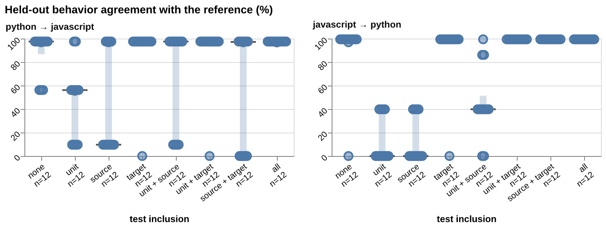
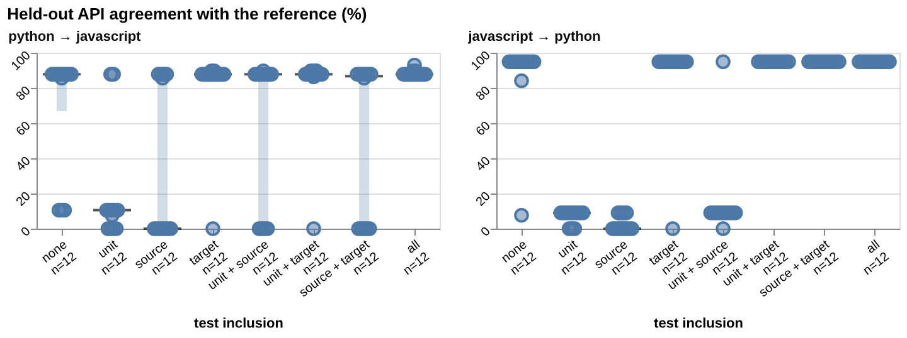
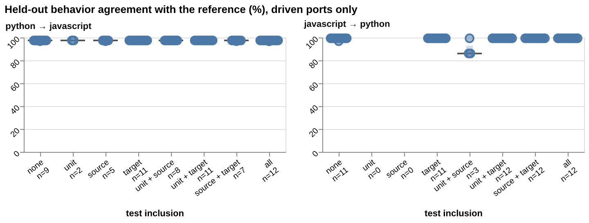
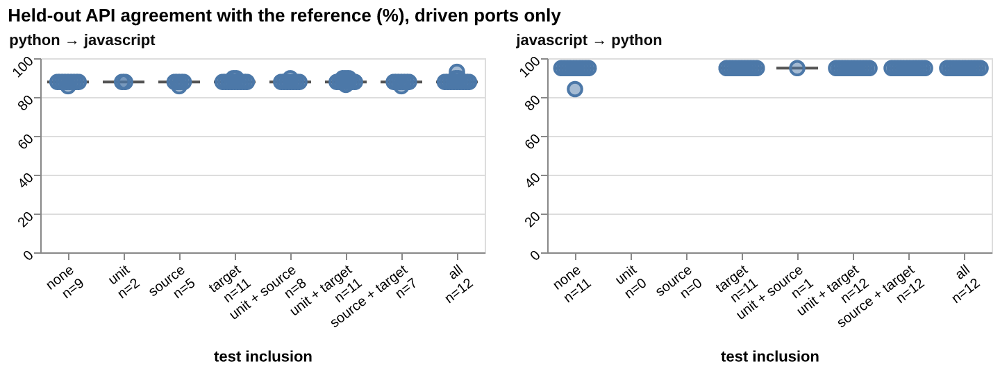
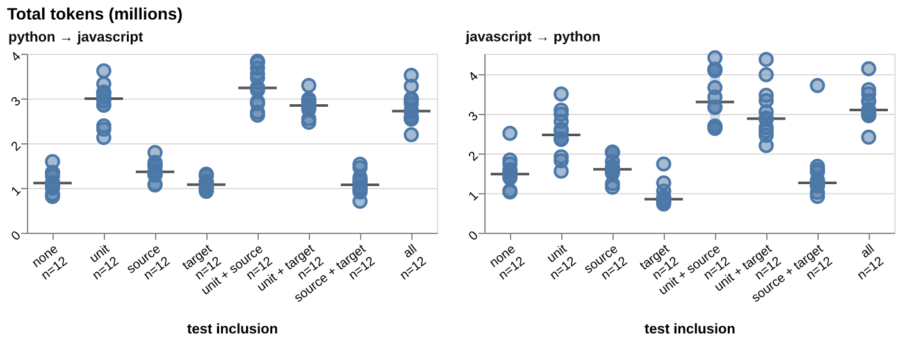
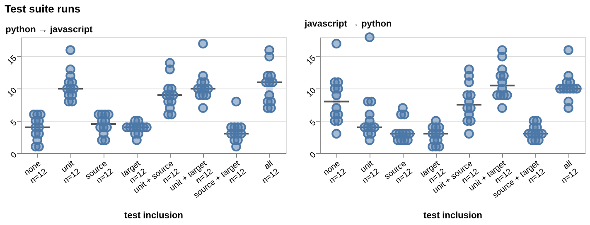
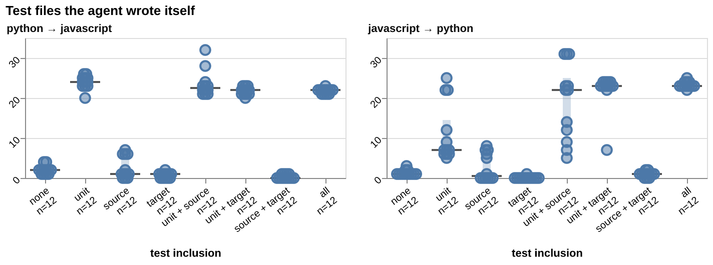
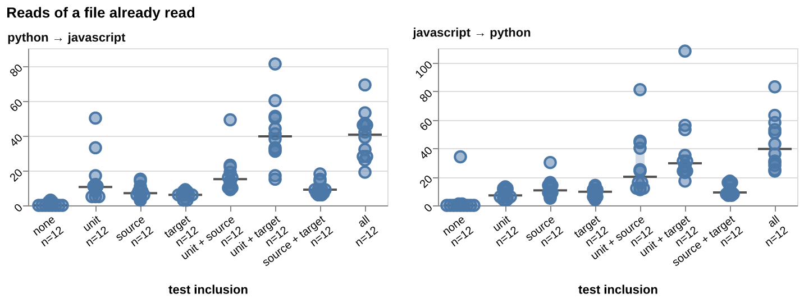
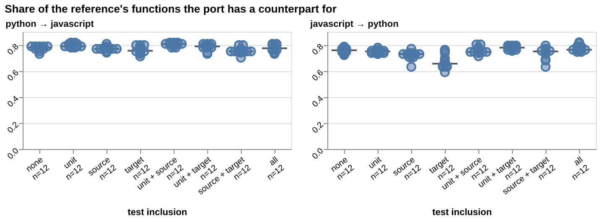
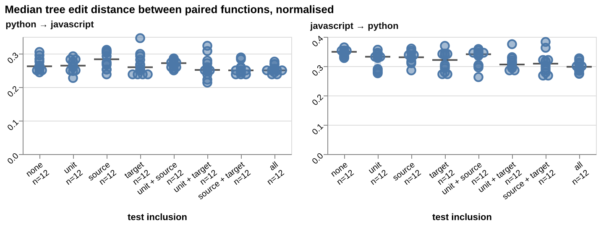

# How including tests changes an LLM's port

2026-10-12

Tests change the port in three ways.

1. **Target-language integration tests decide whether the port exposes the reference's interface.** The held-out driver can run 88 of 96 ports given target tests, 20 of 24 given no tests, and 18 of 72 given unit or source tests without target tests (javascript → python: 0 of 12 with unit tests only, 0 of 12 with source tests only).
2. **Behind that interface, behaviour does not move.** Among ports the driver can run, median agreement with the reference is 97.5% (python → javascript) and 99.4% (javascript → python) of 799 held-out inputs, and 87.8% and 94.9% of 999 API cases, in every cell with a driven port but one (javascript → python with unit + source tests, 86.1%, 3 ports).
3. **Unit tests make the agent do far more work and nudge the code's structure; source tests alone do neither.** With unit tests the median run uses 2.9M tokens instead of 1.2M, runs the suite 9.5 times instead of 4, writes 22.5 test files of its own instead of 1, and pairs 0.78 of the reference's functions instead of 0.75 (p 0.0001); source tests move neither tokens (p 0.48) nor pairing (p 0.77).

Not known yet: the LLM judge and the walkthrough comparison are still running.

## The experiment

- An agent (`claude-opus-5-5`, effort medium) ports the gbnf library between Python and JavaScript.
- Three flags choose the test suites in the sandbox. **unit**: source-language unit tests (internals). **source**: source-language integration tests (behaviour). **target**: target-language integration tests (the expected interface).
- Condition labels name the suites given; "all" is all three.
- 2 directions × 8 combinations × 12 ports = 192 ports.
- Only runs that exited 0 count. Runs per cell, from the five matrix logs of 2026-10-12:

| Direction | Given tests | Successful ports | Exit 1 | Exit 137 |
| --- | --- | --- | --- | --- |
| python → javascript | none | 12 | 4 | 0 |
| python → javascript | unit | 12 | 4 | 0 |
| python → javascript | source | 12 | 4 | 0 |
| python → javascript | target | 12 | 4 | 0 |
| python → javascript | unit + source | 12 | 5 | 0 |
| python → javascript | unit + target | 12 | 5 | 0 |
| python → javascript | source + target | 12 | 4 | 0 |
| python → javascript | all | 12 | 4 | 0 |
| javascript → python | none | 12 | 5 | 3 |
| javascript → python | unit | 12 | 4 | 0 |
| javascript → python | source | 12 | 4 | 3 |
| javascript → python | target | 12 | 4 | 0 |
| javascript → python | unit + source | 12 | 4 | 0 |
| javascript → python | unit + target | 12 | 4 | 0 |
| javascript → python | source + target | 12 | 4 | 1 |
| javascript → python | all | 12 | 4 | 1 |

Charts: one dot per port, a tick at the median, a faint bar over the middle half, one panel per direction, n under each label.

## Target tests decide whether the port speaks the reference's interface

The held-out behaviour measure runs 799 grammar–input pairs the agent never saw through the port and the reference, and counts how often both end the same way (accept, reject, error or crash). It reaches the port through a fixed driver that uses the reference's names, file layout and end-of-input state. So it first tests whether the port exposes that interface at all.



All 192 ports. Scores sit at a few exact levels: 97.5 and 99.4 where the driver runs the port; about 56, 39.8 and 9.6 where it loads the port but its calls or end-state checks fail; 0 where it cannot load the port.



The API measure (999 short call sequences) uses the same kind of driver and has the same shape: 87.8 and 94.9 driven; 10.5, 9.0 and 7.6 loaded but failing; 0 not loaded.

Driver status per cell, from the notebook. `driven`: the port accepted at least one input the reference accepts. `loaded_failing`: it loaded but accepted none. `not_loaded`: every pair crashed. The last column applies the API version (at least one case matching without an error).

| Direction | Given tests | driven | loaded_failing | not_loaded | API driven |
| --- | --- | --- | --- | --- | --- |
| python → javascript | none | 9 | 3 | 0 | 9 |
| python → javascript | unit | 2 | 10 | 0 | 2 |
| python → javascript | source | 5 | 7 | 0 | 5 |
| python → javascript | target | 11 | 0 | 1 | 11 |
| python → javascript | unit + source | 8 | 4 | 0 | 8 |
| python → javascript | unit + target | 11 | 0 | 1 | 11 |
| python → javascript | source + target | 7 | 0 | 5 | 7 |
| python → javascript | all | 12 | 0 | 0 | 12 |
| javascript → python | none | 11 | 0 | 1 | 11 |
| javascript → python | unit | 0 | 4 | 8 | 0 |
| javascript → python | source | 0 | 4 | 8 | 0 |
| javascript → python | target | 11 | 0 | 1 | 11 |
| javascript → python | unit + source | 3 | 7 | 2 | 1 |
| javascript → python | unit + target | 12 | 0 | 0 | 12 |
| javascript → python | source + target | 12 | 0 | 0 | 12 |
| javascript → python | all | 12 | 0 | 0 | 12 |

With target tests, 88 of 96 ports are driven. Without them: 20 of 24 with no tests, 18 of 72 with unit or source tests. The exception is python → javascript with source + target tests: 5 of 12 not loaded. This reads as: source-language tests pull the port toward a layout and names other than the target reference's, and target tests pull it back.

Rerunning the driver on four unit-only ports: both javascript → python ports crashed on all 799 pairs, with `ImportError: cannot import name 'RuleEnd' from 'gbnf'` and `ModuleNotFoundError: No module named 'gbnf'`. Both python → javascript ports loaded, matched all 77 grammar errors, and rejected the other 722 inputs: their end state is not the reference's `type: "end"`.

This does not show that the other ports behave wrongly behind their own interface; that needs a per-port adapter or the judge. The [methodology review](https://github.com/thekevinscott/ports-research/blob/main/notes/REVIEW_2026-10-12-methodology.md) records this as B1 (behaviour) and A2 (API). Measure definitions: [behaviour](https://github.com/thekevinscott/ports-research/blob/3e610fb80bcc3d51cb93142c5b732e2c08fad64b/analysis/measure-behavior/README.md), [API](https://github.com/thekevinscott/ports-research/blob/3e610fb80bcc3d51cb93142c5b732e2c08fad64b/analysis/measure-api/README.md).

All charts and tables for this section: [appendix](APPENDIX.md#held-out-behaviour).

## Behind the interface, behaviour does not move

The same two measures, over driven ports only.





Median agreement over driven ports. n/a: no port in the cell is driven.

| Given tests | python → javascript: driven | behaviour (%) | API (%) | javascript → python: driven | behaviour (%) | API (%) |
| --- | --- | --- | --- | --- | --- | --- |
| none | 9 | 97.5 | 87.8 | 11 | 99.4 | 94.9 |
| unit | 2 | 97.5 | 87.8 | 0 | n/a | n/a |
| source | 5 | 97.5 | 87.8 | 0 | n/a | n/a |
| target | 11 | 97.5 | 87.8 | 11 | 99.4 | 94.9 |
| unit + source | 8 | 97.5 | 87.8 | 3 (API: 1) | 86.1 | 94.9 |
| unit + target | 11 | 97.5 | 87.8 | 12 | 99.4 | 94.9 |
| source + target | 7 | 97.5 | 87.8 | 12 | 99.4 | 94.9 |
| all | 12 | 97.5 | 87.8 | 12 | 99.4 | 94.9 |

The remaining differences are the same kind in every condition. Driven python → javascript ports match all 77 grammar errors; all but one accept 20 inputs the reference rejects (three also error on 5), and one (all tests) differs on 13 accepts and 13 rejects instead. Every driven javascript → python port rejects 5 inputs the reference errors on; one with no tests also rejects 20 the reference accepts, and the two 86.1% ports accept 106 the reference rejects.

This reads as: on this corpus, the given tests change whether the port exposes the reference's interface, not how it behaves behind it.

All charts and tables for this section, including the 16 outcome-pair counts: [appendix](APPENDIX.md#held-out-behaviour) and [API](APPENDIX.md#held-out-api).

## Unit tests make the agent do far more work

Tokens, test-suite runs and the agent's own test files measure effort, from each run's transcript. Tests may cost effort even where they change nothing else.





Runs of pytest, vitest, jest, `node --test` or a package test script.



Test files written into the port that were not copied from the given suites.

Medians per condition.

| Given tests | python → javascript: tokens (M) | suite runs | own test files | javascript → python: tokens (M) | suite runs | own test files |
| --- | --- | --- | --- | --- | --- | --- |
| none | 1.1 | 4 | 2 | 1.5 | 8 | 1 |
| unit | 3.0 | 10 | 24 | 2.5 | 4 | 7 |
| source | 1.4 | 4.5 | 1 | 1.6 | 3 | 0.5 |
| target | 1.1 | 4 | 1 | 0.8 | 3 | 0 |
| unit + source | 3.2 | 9 | 22.5 | 3.3 | 7.5 | 22 |
| unit + target | 2.8 | 10 | 22 | 2.9 | 10.5 | 23 |
| source + target | 1.1 | 3 | 0 | 1.3 | 3 | 1 |
| all | 2.7 | 11 | 22 | 3.1 | 10 | 23 |

Wall time is left out: 48 of the 192 runs, all given unit tests, record under one minute while using 2.2M tokens or more, so the recorded duration does not time the whole run.

Tokens, all 192 runs, flag on against flag off:

- Unit tests: 2.9M against 1.2M, gap +1.7M (95% interval 1.6M to 1.8M), p 0.0001.
- Source tests: 2.3M against 1.8M, gap +0.5M (−0.6M to 1.1M), p 0.48.
- Target tests: 2.2M against 2.0M, gap +0.2M (−1.0M to 0.8M), p 0.82.

All charts and tables for this section: [appendix](APPENDIX.md#work).

## Tests change how the agent reads the reference

Each transcript lists the files the agent read, in order, by class. Reading is the route by which given tests could reach the port.

Runs that touched each given suite (read, ran, searched, edited or named it in a command), and runs with a script that runs both the source and the port (differential script):

| Direction | Given tests | Runs | Touched source tests | Touched target tests | Differential script |
| --- | --- | --- | --- | --- | --- |
| python → javascript | none | 12 | 0 | 0 | 6 |
| python → javascript | unit | 12 | 12 | 0 | 4 |
| python → javascript | source | 12 | 12 | 0 | 5 |
| python → javascript | target | 12 | 0 | 12 | 1 |
| python → javascript | unit + source | 12 | 12 | 0 | 3 |
| python → javascript | unit + target | 12 | 12 | 12 | 4 |
| python → javascript | source + target | 12 | 11 | 12 | 1 |
| python → javascript | all | 12 | 12 | 12 | 4 |
| javascript → python | none | 12 | 7 | 0 | 7 |
| javascript → python | unit | 12 | 12 | 0 | 11 |
| javascript → python | source | 12 | 12 | 0 | 11 |
| javascript → python | target | 12 | 0 | 12 | 4 |
| javascript → python | unit + source | 12 | 12 | 0 | 12 |
| javascript → python | unit + target | 12 | 12 | 12 | 10 |
| javascript → python | source + target | 12 | 12 | 12 | 11 |
| javascript → python | all | 12 | 12 | 12 | 11 |

Every given suite is touched in 12 of 12 runs, except python → javascript with source + target (source tests: 11). With no tests, 7 of 12 javascript → python runs still touched a source-test path.



Reads of a file already read earlier in the run.

Medians per condition.

| Given tests | python → javascript: rereads | files read before first write | javascript → python: rereads | files read before first write |
| --- | --- | --- | --- | --- |
| none | 0 | 40 | 0 | 24 |
| unit | 10.5 | 61.5 | 7 | 21 |
| source | 7 | 44 | 10.5 | 43 |
| target | 6 | 47 | 9.5 | 41 |
| unit + source | 15 | 67.5 | 20 | 59.5 |
| unit + target | 39.5 | 57.5 | 29.5 | 46 |
| source + target | 9 | 47 | 9 | 43 |
| all | 40.5 | 66.5 | 39.5 | 50.5 |

Rereads: 0 with no tests, 6 to 20 in most cells with tests, 29.5 to 40.5 with unit + target or all tests.

Runs by first file read: the first three columns class the first source-code file, the last two the first file of any kind. No run opened a test file or the port first.

| Direction | Given tests | Entry point first | Other source code first | No source code read | First read: source | First read: other |
| --- | --- | --- | --- | --- | --- | --- |
| python → javascript | none | 2 | 10 | 0 | 1 | 11 |
| python → javascript | unit | 1 | 10 | 1 | 10 | 2 |
| python → javascript | source | 7 | 4 | 1 | 12 | 0 |
| python → javascript | target | 5 | 5 | 2 | 0 | 12 |
| python → javascript | unit + source | 1 | 11 | 0 | 6 | 6 |
| python → javascript | unit + target | 4 | 8 | 0 | 0 | 12 |
| python → javascript | source + target | 3 | 5 | 4 | 0 | 12 |
| python → javascript | all | 7 | 4 | 1 | 0 | 12 |
| javascript → python | none | 1 | 10 | 1 | 0 | 12 |
| javascript → python | unit | 0 | 3 | 9 | 1 | 11 |
| javascript → python | source | 2 | 10 | 0 | 0 | 12 |
| javascript → python | target | 5 | 5 | 2 | 0 | 12 |
| javascript → python | unit + source | 4 | 8 | 0 | 0 | 12 |
| javascript → python | unit + target | 2 | 10 | 0 | 2 | 10 |
| javascript → python | source + target | 7 | 3 | 2 | 0 | 12 |
| javascript → python | all | 5 | 7 | 0 | 1 | 11 |

All charts and tables for this section: [appendix](APPENDIX.md#reading).

## The code's structure barely moves

The structure measures pair the port's functions with the reference's by name and parameter count, then compare paired functions' syntax trees. They measure drift from the reference's design, not quality.



Paired functions over the reference's functions; 1 means every reference function has a partner.



Tree edits to turn one paired function into the other, over the larger tree's size; 0 same shape, 1 nothing shared.

Median [25th, 75th percentile] per condition.

| Direction | Given tests | n | Reference functions paired (share) | Paired tree distance | Branching distribution distance |
| --- | --- | --- | --- | --- | --- |
| python → javascript | none | 12 | 0.78 [0.77, 0.79] | 0.26 [0.25, 0.28] | 0.27 [0.25, 0.29] |
| python → javascript | unit | 12 | 0.79 [0.79, 0.81] | 0.26 [0.25, 0.28] | 0.31 [0.28, 0.34] |
| python → javascript | source | 12 | 0.77 [0.77, 0.78] | 0.28 [0.26, 0.3] | 0.27 [0.25, 0.29] |
| python → javascript | target | 12 | 0.75 [0.75, 0.78] | 0.26 [0.24, 0.28] | 0.36 [0.35, 0.38] |
| python → javascript | unit + source | 12 | 0.81 [0.8, 0.81] | 0.27 [0.26, 0.28] | 0.31 [0.25, 0.34] |
| python → javascript | unit + target | 12 | 0.79 [0.78, 0.8] | 0.25 [0.25, 0.27] | 0.31 [0.27, 0.35] |
| python → javascript | source + target | 12 | 0.75 [0.75, 0.76] | 0.25 [0.24, 0.26] | 0.39 [0.36, 0.43] |
| python → javascript | all | 12 | 0.77 [0.76, 0.8] | 0.25 [0.25, 0.26] | 0.33 [0.31, 0.37] |
| javascript → python | none | 12 | 0.76 [0.74, 0.77] | 0.35 [0.33, 0.35] | 0.27 [0.22, 0.32] |
| javascript → python | unit | 12 | 0.75 [0.74, 0.75] | 0.33 [0.29, 0.34] | 0.23 [0.22, 0.25] |
| javascript → python | source | 12 | 0.73 [0.71, 0.73] | 0.33 [0.32, 0.34] | 0.22 [0.18, 0.23] |
| javascript → python | target | 12 | 0.66 [0.64, 0.71] | 0.32 [0.29, 0.34] | 0.2 [0.17, 0.24] |
| javascript → python | unit + source | 12 | 0.75 [0.75, 0.77] | 0.34 [0.3, 0.35] | 0.24 [0.21, 0.28] |
| javascript → python | unit + target | 12 | 0.78 [0.76, 0.79] | 0.31 [0.3, 0.32] | 0.26 [0.21, 0.29] |
| javascript → python | source + target | 12 | 0.75 [0.72, 0.76] | 0.31 [0.28, 0.32] | 0.24 [0.22, 0.27] |
| javascript → python | all | 12 | 0.76 [0.76, 0.79] | 0.3 [0.29, 0.31] | 0.24 [0.22, 0.27] |

Flag on against flag off, all 192 runs, the gaps with p under 0.01:

- Unit tests raise the paired share by 0.03 (0.02 to 0.04), p 0.0001.
- Unit tests raise the call-order difference by 0.07 (0.06 to 0.09), p 0.0005; target tests lower it by 0.07 (−0.09 to −0.07), p 0.0001. It is traced only from functions both sides export, so it too depends on the interface.
- Unit tests add 30.5 lines of code (12 to 63.5), p 0.0012; target tests add 26 (8.5 to 55), p 0.0023.

Not under 0.01: tree distance for every flag (p 0.06 or more), branching distance (closest: target, +0.03, p 0.015), the share of the reference's call links kept (p 0.64 or more), and source tests on every structure measure (p 0.58 or more).

All charts and tables for this section: [appendix](APPENDIX.md#structure).

## Which differences are larger than chance

For each flag, the 96 runs with it on are compared with the 96 with it off, directions pooled; the gap is the on median minus the off median. p is the share of 10,000 label reshuffles giving a gap at least as large; the interval is a 95% bootstrap range. Many tests run uncorrected, so this is a screen, not a confirmation.

Gap [95% interval], p, per flag.

| Measure | Unit tests | Source tests | Target tests |
| --- | --- | --- | --- |
| Behaviour agreement (%) | 0 [−1.88, 0], p 1 | 0 [−11.39, 0], p 1 | +57.7 [28.22, 59.57], p 0.0001 |
| API agreement (%) | 0 [−7.11, 0], p 1 | 0 [−40.49, 0], p 1 | +82.33 [78.23, 85.89], p 0.0001 |
| Share of reference functions paired | +0.03 [0.02, 0.04], p 0.0001 | −0.01 [−0.02, 0.01], p 0.77 | −0.01 [−0.02, 0.01], p 0.78 |
| Tree distance of paired functions | −0.01 [−0.03, 0.01], p 0.18 | 0 [−0.02, 0.01], p 0.68 | −0.01 [−0.04, 0], p 0.06 |
| Branching distance | +0.01 [−0.02, 0.04], p 0.36 | −0.01 [−0.04, 0.02], p 0.79 | +0.03 [0, 0.07], p 0.015 |
| Share of reference call links kept | +0.04 [−0.11, 0.11], p 0.64 | 0 [−0.11, 0.12], p 0.999 | 0 [−0.11, 0.12], p 0.998 |
| Call-order difference | +0.07 [0.06, 0.09], p 0.0005 | +0.01 [−0.03, 0.05], p 0.58 | −0.07 [−0.09, −0.07], p 0.0001 |
| Total tokens (M) | +1.7 [1.6, 1.8], p 0.0001 | +0.5 [−0.6, 1.1], p 0.48 | +0.2 [−1.0, 0.8], p 0.82 |
| Lines of code | +30.5 [12, 63.5], p 0.0012 | +4.5 [−15, 21.5], p 0.71 | +26 [8.5, 55], p 0.0023 |
| Reads of source tests | +8 [6.5, 9], p 0.0001 | +4.5 [1, 7], p 0.0001 | −1 [−3, 3.5], p 0.33 |
| Reads of target tests | 0 [−3, 3], p 1 | 0 [−3, 3], p 1 | +3 [3, 4], p 0.11 |
| Test-suite runs | +5.5 [5, 7], p 0.0001 | 0 [−3, 2], p 1 | +1 [−2, 3], p 0.35 |
| Own test files | +21.5 [21, 22], p 0.0001 | +2.5 [−5, 19], p 0.29 | −1.5 [−6, 16], p 0.49 |
| Files read before first write | +12.5 [8.5, 20], p 0.0001 | +5 [0, 9], p 0.0008 | +4 [1.5, 6.5], p 0.0079 |
| Rereads | +17.5 [11, 24], p 0.0001 | +6 [3, 10], p 0.0006 | +8 [3, 17.5], p 0.0001 |

The behaviour and API gaps for unit and source tests are 0 because both medians land on the driven level; the change is in how many ports are driven (see above).

Spearman ρ ranks the 192 runs on two measures: +1 same order, −1 reverse, 0 unrelated. The ten measures that rank most closely with behaviour agreement:

| Measure | ρ with behaviour agreement |
| --- | --- |
| API agreement | 0.977 |
| Inputs both accept | 0.959 |
| Inputs both error on | 0.622 |
| Reference accepts, port crashes | −0.621 |
| Reference rejects, port crashes | −0.621 |
| Reference errors, port crashes | −0.621 |
| Reference errors, port rejects | 0.617 |
| Reads of target tests | 0.458 |
| Reference rejects, port errors | −0.447 |
| Inputs both reject | 0.442 |

Two measures, branching distance and the share of reference functions paired, show exactly 0; that is under review.

All 15 flag tables, per-direction rows and the full Spearman table: [appendix](APPENDIX.md#statistics).

## Not yet measured

- Embeddings: no V2 charts; the notebook's embedding charts select V1 runs only, and the pair export failed with `ValueError: cached file selection differs from source`.
- Judge: in progress, both rubrics (code and transcript).
- Walkthroughs: in progress.

Their definitions: [appendix](APPENDIX.md#not-yet-measured).

## What this report does not do

It draws no conclusions; results are reviewed with Kevin. It does not measure reference diff similarity (no JavaScript target in `measure-code-distance`) or test pass rates (`execute-test-suite` finds no V2 suite). The [methodology review](https://github.com/thekevinscott/ports-research/blob/main/notes/REVIEW_2026-10-12-methodology.md) records the measurement limits.

## How this was made

The charts are exports of the [analysis notebook](https://github.com/thekevinscott/ports-research/blob/8999c36b8d8ed765f20682fc54f9799a317750ad/analysis/notebook/runs.py) at commit `8999c36`, over the 192 runs of the five matrix logs. The two driven-only charts and total tokens were built at commit `3e610fb` by the notebook's `behavior_chart` on cached measure data and written with the exporter's `write_chart`; the raw behaviour chart rebuilt this way matches the export byte for byte. The driver-status counts are the notebook's `driver_status_counts` ([PR #165](https://github.com/thekevinscott/ports-research/pull/165)). Commands, from the [notebook README](https://github.com/thekevinscott/ports-research/blob/3e610fb80bcc3d51cb93142c5b732e2c08fad64b/analysis/notebook/README.md):

```sh
PORTS_RUNS_DIR=<selected runs> GENERATE_EMBEDDING_BASE_URL=<tower>/v1 UV_NO_CONFIG=1 uv run --directory analysis/notebook python export_charts.py
PORTS_RUNS_DIR=<selected runs> UV_NO_CONFIG=1 uv run --directory analysis/notebook python export_embedding_pairs.py
```

`<selected runs>` held only the five matrices' run directories and the V1 inputs the exporter requires. The driver-status counts and the three added charts select the same runs with `PORTS_MATRICES=matrix-20261012T{021310,094953,100920,110350,120814}Z.jsonl`.
