# What effect does including tests have on an LLM's port?

2026-10-12

The question, in Kevin's words: “what effect does test inclusion have on produced output”. Each section below asks one part of it.

An agent (`claude-opus-5-5`, effort medium) ports the gbnf library between Python and JavaScript. Three flags control which test suites it is given: `include_unit_tests` (unit tests, which describe internals), `include_source_integration_tests` (integration tests in the source language, which describe behaviour), and `include_target_integration_tests` (integration tests in the target language, which describe the expected interface). 2 source languages × 8 flag combinations = 16 cells × 12 runs = 192 ports.

Condition labels name the suites given: “unit”, “source”, “target”, “all” (all three), “none”. Runs per cell, from the five matrix logs of 2026-10-12 (`matrix-20261012T{021310,094953,100920,110350,120814}Z.jsonl`); only exit-0 runs appear in the charts and tables below.

| Source | Given tests | Successful ports | Exit 1 | Exit 137 |
| --- | --- | --- | --- | --- |
| python | none | 12 | 4 | 0 |
| python | unit | 12 | 4 | 0 |
| python | source | 12 | 4 | 0 |
| python | target | 12 | 4 | 0 |
| python | unit + source | 12 | 5 | 0 |
| python | unit + target | 12 | 5 | 0 |
| python | source + target | 12 | 4 | 0 |
| python | all | 12 | 4 | 0 |
| javascript | none | 12 | 5 | 3 |
| javascript | unit | 12 | 4 | 0 |
| javascript | source | 12 | 4 | 3 |
| javascript | target | 12 | 4 | 0 |
| javascript | unit + source | 12 | 4 | 0 |
| javascript | unit + target | 12 | 4 | 0 |
| javascript | source + target | 12 | 4 | 1 |
| javascript | all | 12 | 4 | 1 |

Every per-run chart has one dot per port, a tick at the condition's median, a faint bar over the interquartile range (IQR, the middle half of the ports), one panel per source language (titled source → target), and n under each label counting ports with a value. Captions abbreviate this as “Dots: ports; tick: median; bar: IQR; panels: source language.”

## Does including tests change what the port does?

**Why.** Counted: 100 held-out grammars and 799 grammar–input pairs, never given to the agent, are run through the port and through the reference in the target language; each pair ends in accept, reject, error or crash on each side. Agreement is the share of the 799 pairs with the same outcome on both sides. High (near 100%) means the port behaves like the reference on these inputs, errors included; low means it accepts, rejects, errors or crashes where the reference does not. Hypothesis: source and target integration tests raise agreement because they show behaviour by example; unit tests may raise it on internal cases. A difference between conditions would show the given tests changed behaviour on this corpus; it would not show correctness on other inputs, or that the reference's behaviour is right. Why it matters: this is the direct check of whether the port does what the original does. [Measure definition](https://github.com/thekevinscott/ports-research/blob/8999c36b8d8ed765f20682fc54f9799a317750ad/analysis/measure-behavior/README.md).


Share of the 799 held-out pairs on which the port's outcome equals the reference's, in percent. Dots: ports; tick: median; bar: IQR; panels: source language.

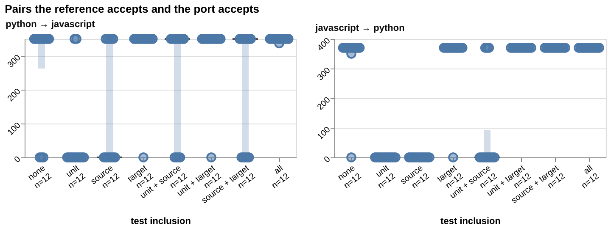

Count of the 799 pairs on which the reference accepts the input and the port accepts it. Dots: ports; tick: median; bar: IQR; panels: source language.

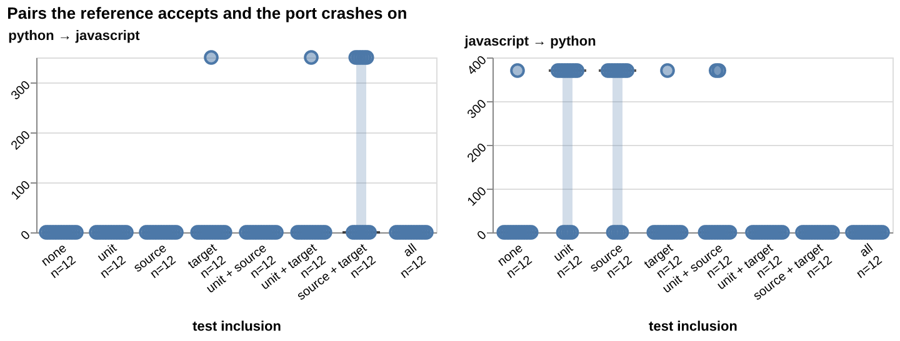

Count of the 799 pairs on which the reference accepts the input and the port crashes on it. Dots: ports; tick: median; bar: IQR; panels: source language.

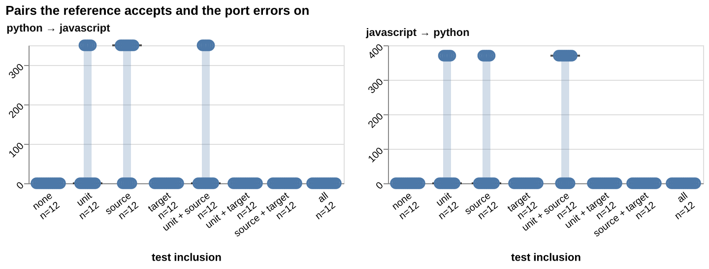

Count of the 799 pairs on which the reference accepts the input and the port raises an error on it. Dots: ports; tick: median; bar: IQR; panels: source language.

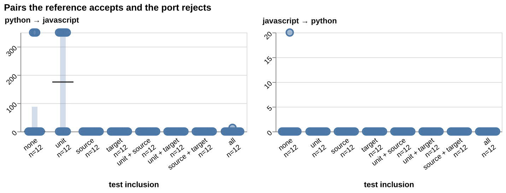

Count of the 799 pairs on which the reference accepts the input and the port rejects it. Dots: ports; tick: median; bar: IQR; panels: source language.

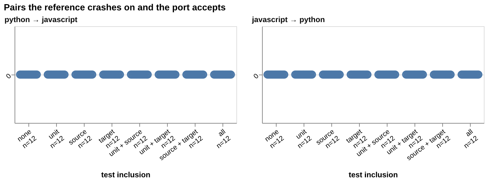

Count of the 799 pairs on which the reference crashes on the input and the port accepts it. Dots: ports; tick: median; bar: IQR; panels: source language.


Count of the 799 pairs on which the reference crashes on the input and the port crashes on it. Dots: ports; tick: median; bar: IQR; panels: source language.


Count of the 799 pairs on which the reference crashes on the input and the port raises an error on it. Dots: ports; tick: median; bar: IQR; panels: source language.

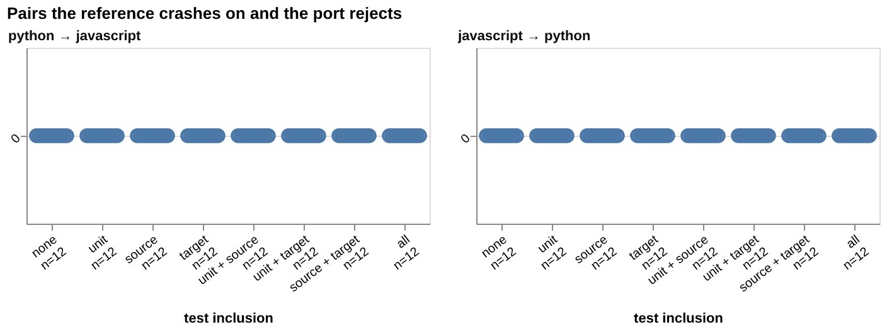

Count of the 799 pairs on which the reference crashes on the input and the port rejects it. Dots: ports; tick: median; bar: IQR; panels: source language.

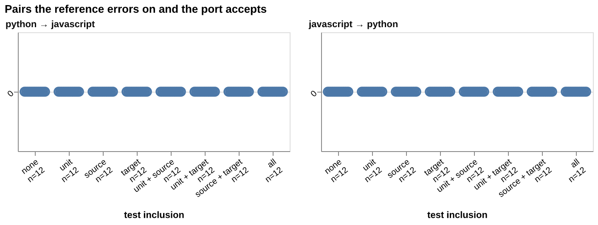

Count of the 799 pairs on which the reference raises an error on the input and the port accepts it. Dots: ports; tick: median; bar: IQR; panels: source language.

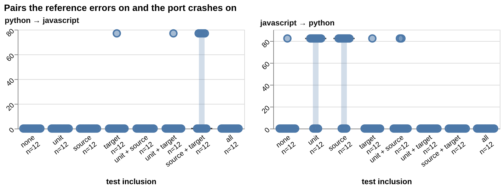

Count of the 799 pairs on which the reference raises an error on the input and the port crashes on it. Dots: ports; tick: median; bar: IQR; panels: source language.

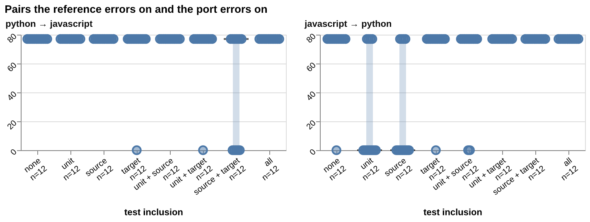

Count of the 799 pairs on which the reference raises an error on the input and the port raises an error on it. Dots: ports; tick: median; bar: IQR; panels: source language.

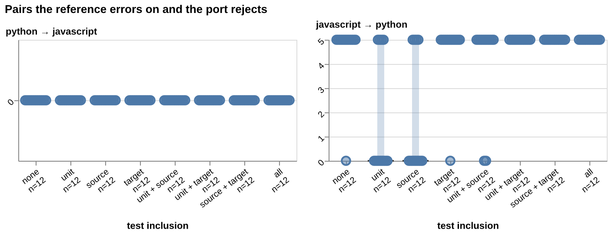

Count of the 799 pairs on which the reference raises an error on the input and the port rejects it. Dots: ports; tick: median; bar: IQR; panels: source language.

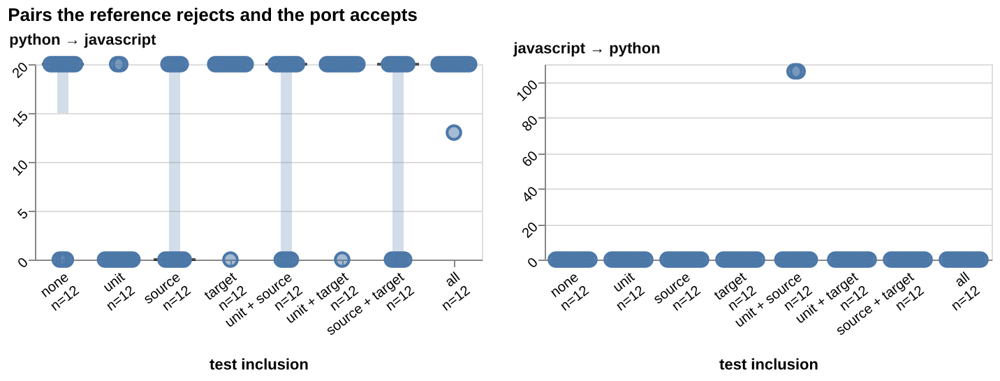

Count of the 799 pairs on which the reference rejects the input and the port accepts it. Dots: ports; tick: median; bar: IQR; panels: source language.

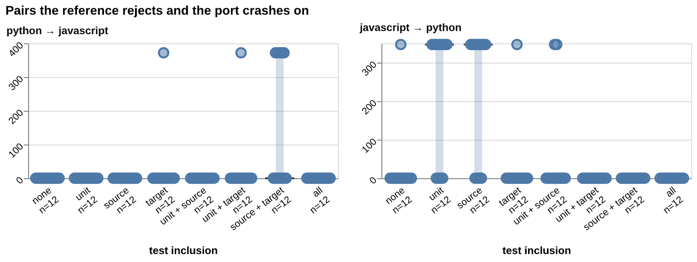

Count of the 799 pairs on which the reference rejects the input and the port crashes on it. Dots: ports; tick: median; bar: IQR; panels: source language.

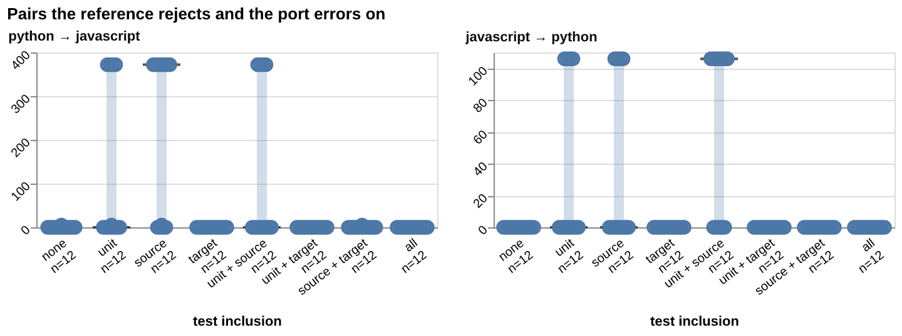

Count of the 799 pairs on which the reference rejects the input and the port raises an error on it. Dots: ports; tick: median; bar: IQR; panels: source language.

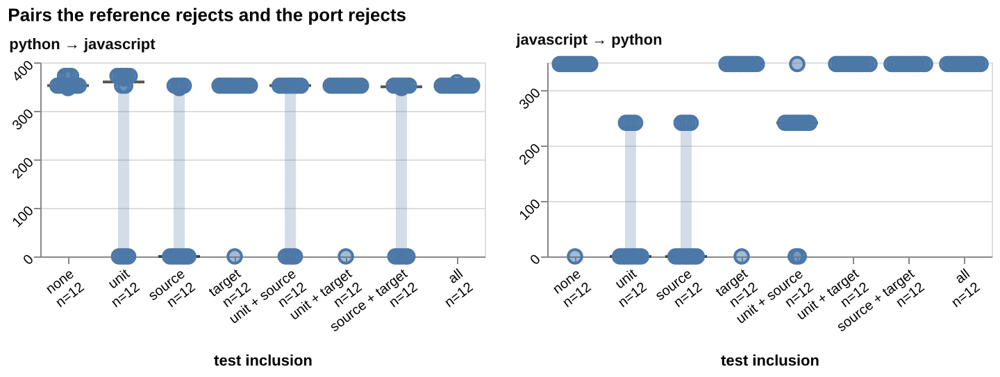

Count of the 799 pairs on which the reference rejects the input and the port rejects it. Dots: ports; tick: median; bar: IQR; panels: source language.

Median [25th, 75th percentile] per condition, from the notebook; n counts successful ports.

| Source | Given tests | n | Behaviour agreement (%) |
| --- | --- | --- | --- |
| python | none | 12 | 97.5 [86.7, 97.5] |
| python | unit | 12 | 56.2 [9.64, 56.2] |
| python | source | 12 | 9.64 [9.64, 97.5] |
| python | target | 12 | 97.5 [97.5, 97.5] |
| python | unit + source | 12 | 97.5 [9.64, 97.5] |
| python | unit + target | 12 | 97.5 [97.5, 97.5] |
| python | source + target | 12 | 97.18 [0.0, 97.5] |
| python | all | 12 | 97.5 [97.5, 97.5] |
| javascript | none | 12 | 99.37 [99.37, 99.37] |
| javascript | unit | 12 | 0.0 [0.0, 39.8] |
| javascript | source | 12 | 0.0 [0.0, 39.8] |
| javascript | target | 12 | 99.37 [99.37, 99.37] |
| javascript | unit + source | 12 | 39.8 [39.8, 51.38] |
| javascript | unit + target | 12 | 99.37 [99.37, 99.37] |
| javascript | source + target | 12 | 99.37 [99.37, 99.37] |
| javascript | all | 12 | 99.37 [99.37, 99.37] |

Pairs summed over each condition's ports (12 × 799 = 9,588); each column is reference outcome → port outcome.

| Source | Given tests | Ports | accept → accept | accept → reject | accept → error | accept → crash | reject → accept | reject → reject | reject → error | reject → crash | error → accept | error → reject | error → error | error → crash | crash → accept | crash → reject | crash → error | crash → crash |
| --- | --- | --- | --- | --- | --- | --- | --- | --- | --- | --- | --- | --- | --- | --- | --- | --- | --- | --- |
| python | none | 12 | 3150 | 1050 | 0 | 0 | 180 | 4279 | 5 | 0 | 0 | 0 | 924 | 0 | 0 | 0 | 0 | 0 |
| python | unit | 12 | 700 | 2100 | 1400 | 0 | 40 | 2931 | 1493 | 0 | 0 | 0 | 924 | 0 | 0 | 0 | 0 | 0 |
| python | source | 12 | 1750 | 0 | 2450 | 0 | 100 | 1755 | 2609 | 0 | 0 | 0 | 924 | 0 | 0 | 0 | 0 | 0 |
| python | target | 12 | 3850 | 0 | 0 | 350 | 220 | 3872 | 0 | 372 | 0 | 0 | 847 | 77 | 0 | 0 | 0 | 0 |
| python | unit + source | 12 | 2800 | 0 | 1400 | 0 | 160 | 2816 | 1488 | 0 | 0 | 0 | 924 | 0 | 0 | 0 | 0 | 0 |
| python | unit + target | 12 | 3850 | 0 | 0 | 350 | 220 | 3872 | 0 | 372 | 0 | 0 | 847 | 77 | 0 | 0 | 0 | 0 |
| python | source + target | 12 | 2450 | 0 | 0 | 1750 | 140 | 2459 | 5 | 1860 | 0 | 0 | 539 | 385 | 0 | 0 | 0 | 0 |
| python | all | 12 | 4187 | 13 | 0 | 0 | 233 | 4231 | 0 | 0 | 0 | 0 | 924 | 0 | 0 | 0 | 0 | 0 |
| javascript | none | 12 | 4050 | 20 | 0 | 370 | 0 | 3817 | 0 | 347 | 0 | 55 | 847 | 82 | 0 | 0 | 0 | 0 |
| javascript | unit | 12 | 0 | 0 | 1480 | 2960 | 0 | 964 | 424 | 2776 | 0 | 20 | 308 | 656 | 0 | 0 | 0 | 0 |
| javascript | source | 12 | 0 | 0 | 1480 | 2960 | 0 | 964 | 424 | 2776 | 0 | 20 | 308 | 656 | 0 | 0 | 0 | 0 |
| javascript | target | 12 | 4070 | 0 | 0 | 370 | 0 | 3817 | 0 | 347 | 0 | 55 | 847 | 82 | 0 | 0 | 0 | 0 |
| javascript | unit + source | 12 | 1110 | 0 | 2590 | 740 | 212 | 2516 | 742 | 694 | 0 | 50 | 770 | 164 | 0 | 0 | 0 | 0 |
| javascript | unit + target | 12 | 4440 | 0 | 0 | 0 | 0 | 4164 | 0 | 0 | 0 | 60 | 924 | 0 | 0 | 0 | 0 | 0 |
| javascript | source + target | 12 | 4440 | 0 | 0 | 0 | 0 | 4164 | 0 | 0 | 0 | 60 | 924 | 0 | 0 | 0 | 0 | 0 |
| javascript | all | 12 | 4440 | 0 | 0 | 0 | 0 | 4164 | 0 | 0 | 0 | 60 | 924 | 0 | 0 | 0 | 0 | 0 |

## Does including tests change the port's public interface?

**Why.** Counted: 999 held-out API cases over the same 100 grammars, each a short call sequence (build the grammar, add a whole input, then add up to 16 characters one at a time) run on the port and the reference. A case agrees when every step returns the same set of next grammar rules, or raises the same error class at the same position. Agreement is the share of the 999 cases. High means a caller gets the same answers from the port's interface as from the reference's; low means steps differ or crash. Hypothesis: target integration tests raise agreement because they spell out the target-language interface; source integration tests may raise it through behaviour. A difference would show the given tests changed answers on these calls; it would not show that the whole public API matches or that every caller would work. Why it matters: a port with the right behaviour behind a different interface is not a drop-in replacement. [Measure definition](https://github.com/thekevinscott/ports-research/blob/8999c36b8d8ed765f20682fc54f9799a317750ad/analysis/measure-api/README.md).


Share of the 999 held-out API cases on which every step returns what the reference returns, matching errors included, in percent. Dots: ports; tick: median; bar: IQR; panels: source language.

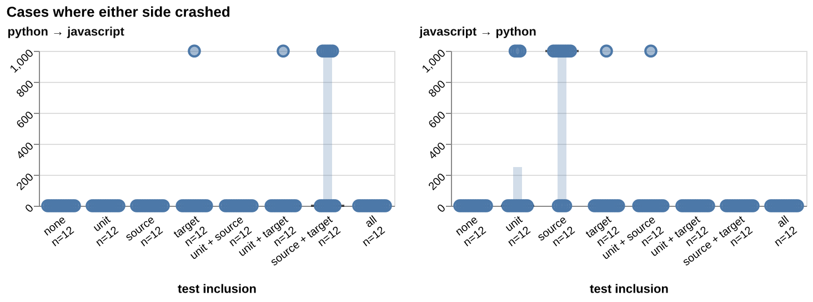

Count of cases where the port or the reference crashes (10 s timeout, non-zero exit, or no output). Dots: ports; tick: median; bar: IQR; panels: source language.

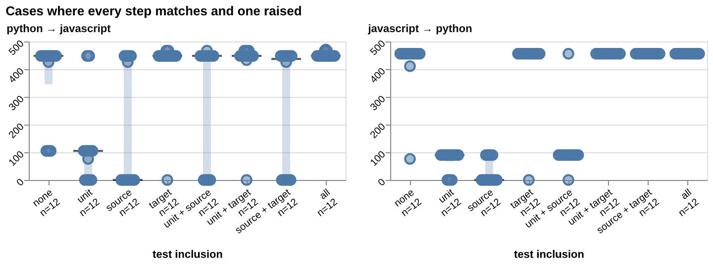

Count of cases where every step matches and at least one step raises the same error on both sides. Dots: ports; tick: median; bar: IQR; panels: source language.

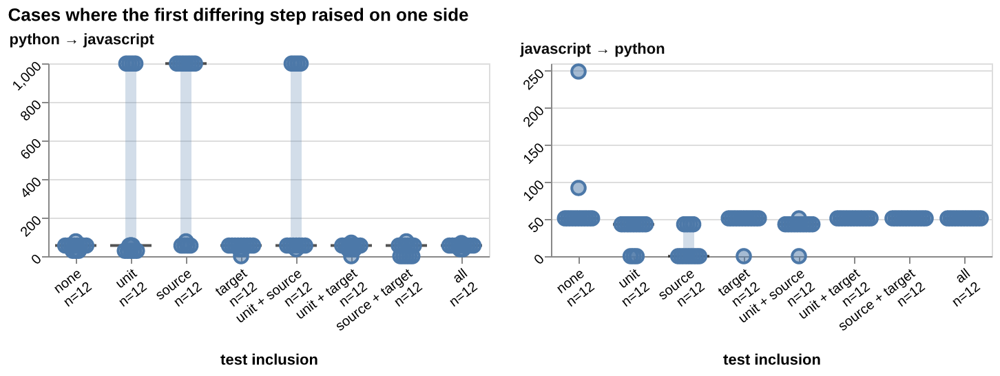

Count of cases whose first unequal step raises on at least one side, or is missing on one side. Dots: ports; tick: median; bar: IQR; panels: source language.

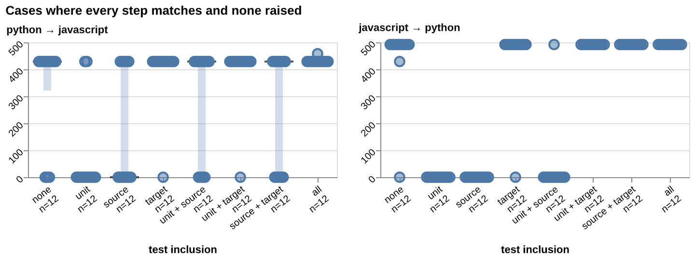

Count of the 999 cases where every step returns the same rules on both sides and none raises. Dots: ports; tick: median; bar: IQR; panels: source language.

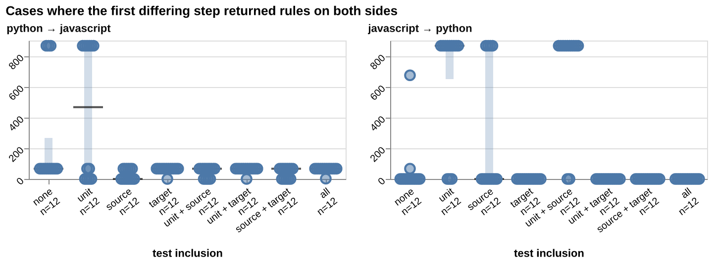

Count of cases whose first unequal step returns rules on both sides, but different ones. Dots: ports; tick: median; bar: IQR; panels: source language.

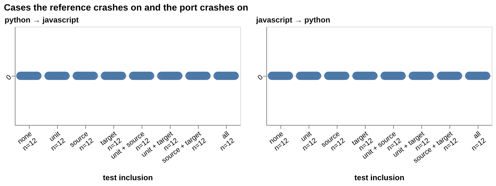

Count of the 999 cases where the reference crashes and the port crashes. Dots: ports; tick: median; bar: IQR; panels: source language.

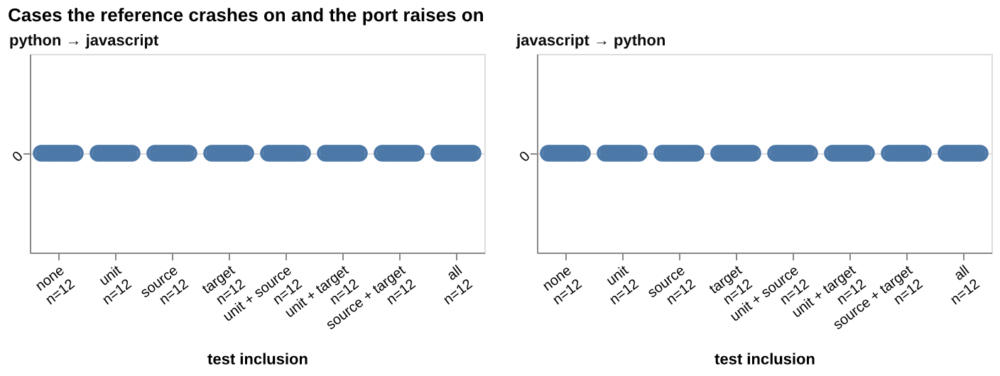

Count of the 999 cases where the reference crashes and the port raises an error. Dots: ports; tick: median; bar: IQR; panels: source language.

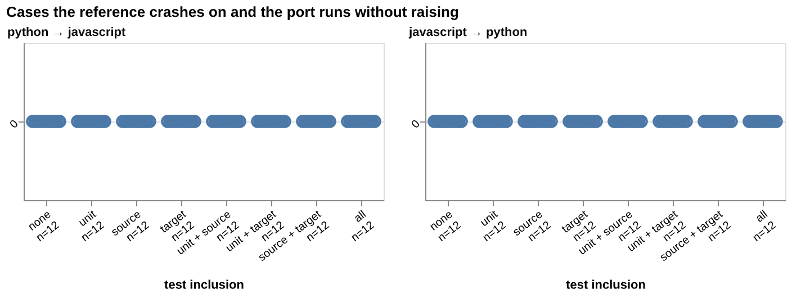

Count of the 999 cases where the reference crashes and the port runs without error. Dots: ports; tick: median; bar: IQR; panels: source language.

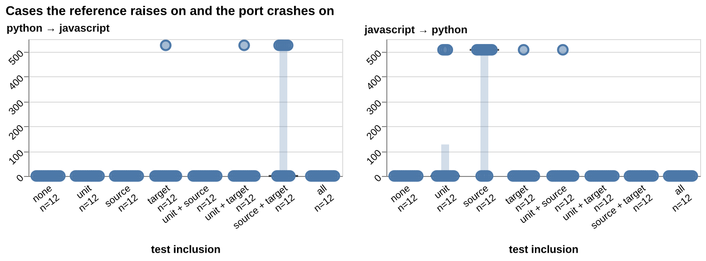

Count of the 999 cases where the reference raises an error and the port crashes. Dots: ports; tick: median; bar: IQR; panels: source language.

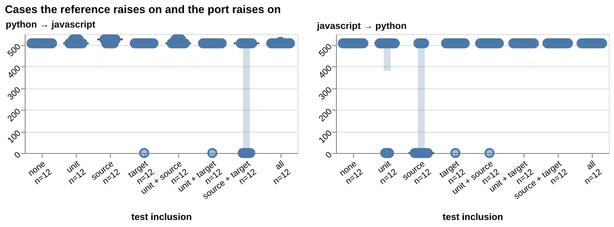

Count of the 999 cases where the reference raises an error and the port raises an error. Dots: ports; tick: median; bar: IQR; panels: source language.

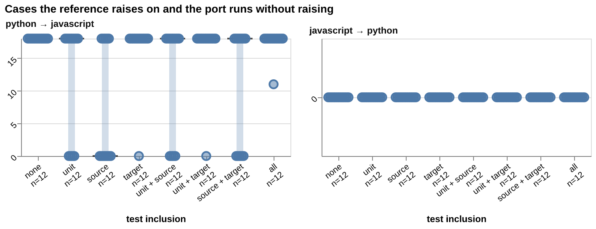

Count of the 999 cases where the reference raises an error and the port runs without error. Dots: ports; tick: median; bar: IQR; panels: source language.

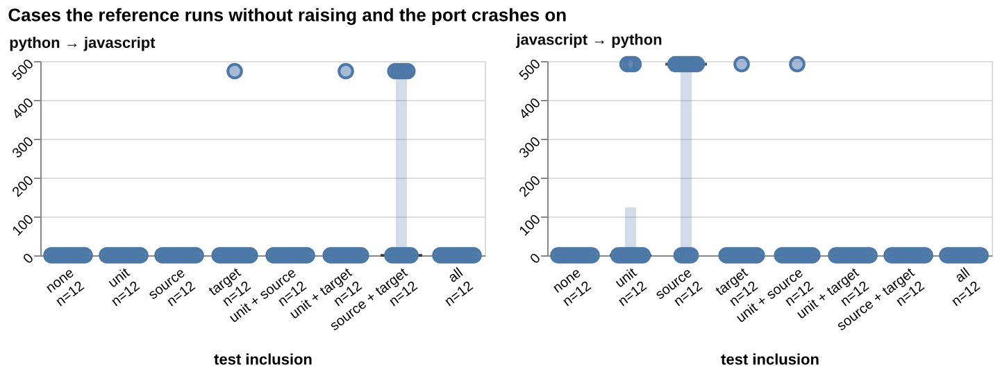

Count of the 999 cases where the reference runs without error and the port crashes. Dots: ports; tick: median; bar: IQR; panels: source language.

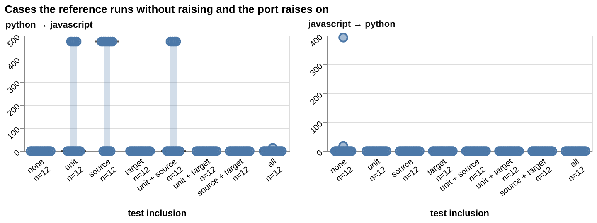

Count of the 999 cases where the reference runs without error and the port raises an error. Dots: ports; tick: median; bar: IQR; panels: source language.

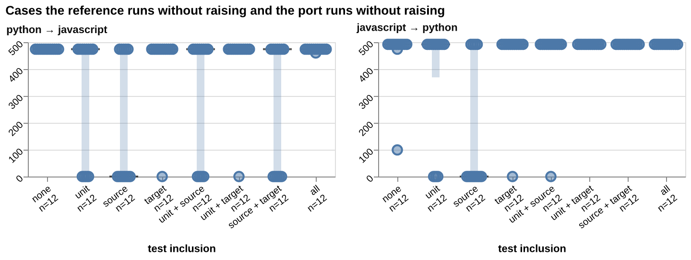

Count of the 999 cases where the reference runs without error and the port runs without error. Dots: ports; tick: median; bar: IQR; panels: source language.

Median [25th, 75th percentile] per condition, from the notebook; n counts successful ports.

| Source | Given tests | n | API agreement (%) |
| --- | --- | --- | --- |
| python | none | 12 | 87.79 [66.82, 87.79] |
| python | unit | 12 | 10.51 [0.0, 10.51] |
| python | source | 12 | 0.0 [0.0, 87.79] |
| python | target | 12 | 87.79 [87.79, 87.79] |
| python | unit + source | 12 | 87.79 [0.0, 87.79] |
| python | unit + target | 12 | 87.79 [87.79, 88.26] |
| python | source + target | 12 | 86.69 [0.0, 87.79] |
| python | all | 12 | 87.79 [87.79, 88.26] |
| javascript | none | 12 | 94.89 [94.89, 94.89] |
| javascript | unit | 12 | 9.01 [6.76, 9.01] |
| javascript | source | 12 | 0.0 [0.0, 9.01] |
| javascript | target | 12 | 94.89 [94.89, 94.89] |
| javascript | unit + source | 12 | 9.01 [9.01, 9.01] |
| javascript | unit + target | 12 | 94.89 [94.89, 94.89] |
| javascript | source + target | 12 | 94.89 [94.89, 94.89] |
| javascript | all | 12 | 94.89 [94.89, 94.89] |

API cases summed over each condition's ports (12 × 999 = 11,988), by outcome as in the charts above.

| Source | Given tests | Ports | match | mismatch | error match | error mismatch | crash |
| --- | --- | --- | --- | --- | --- | --- | --- |
| python | none | 12 | 3861 | 3201 | 4325 | 601 | 0 |
| python | unit | 12 | 858 | 5330 | 1497 | 4303 | 0 |
| python | source | 12 | 2145 | 335 | 2218 | 7290 | 0 |
| python | target | 12 | 4719 | 737 | 4966 | 567 | 999 |
| python | unit + source | 12 | 3432 | 536 | 3603 | 4417 | 0 |
| python | unit + target | 12 | 4719 | 737 | 4970 | 563 | 999 |
| python | source + target | 12 | 3003 | 469 | 3114 | 407 | 4995 |
| python | all | 12 | 5177 | 739 | 5437 | 635 | 0 |
| javascript | none | 12 | 5349 | 741 | 5047 | 851 | 0 |
| javascript | unit | 12 | 0 | 7794 | 810 | 387 | 2997 |
| javascript | source | 12 | 0 | 3464 | 360 | 172 | 7992 |
| javascript | target | 12 | 5412 | 0 | 5016 | 561 | 999 |
| javascript | unit + source | 12 | 492 | 8660 | 1356 | 481 | 999 |
| javascript | unit + target | 12 | 5904 | 0 | 5472 | 612 | 0 |
| javascript | source + target | 12 | 5904 | 0 | 5472 | 612 | 0 |
| javascript | all | 12 | 5904 | 0 | 5472 | 612 | 0 |

API cases summed over the same ports, by reference status → port status: “ok” no step raised, “error” at least one step raised.

| Source | Given tests | ok → ok | ok → error | ok → crash | error → ok | error → error | error → crash | crash → ok | crash → error | crash → crash |
| --- | --- | --- | --- | --- | --- | --- | --- | --- | --- | --- |
| python | none | 5688 | 0 | 0 | 216 | 6084 | 0 | 0 | 0 | 0 |
| python | unit | 3792 | 1896 | 0 | 144 | 6156 | 0 | 0 | 0 | 0 |
| python | source | 2370 | 3318 | 0 | 90 | 6210 | 0 | 0 | 0 | 0 |
| python | target | 5214 | 0 | 474 | 198 | 5577 | 525 | 0 | 0 | 0 |
| python | unit + source | 3792 | 1896 | 0 | 144 | 6156 | 0 | 0 | 0 | 0 |
| python | unit + target | 5214 | 0 | 474 | 198 | 5577 | 525 | 0 | 0 | 0 |
| python | source + target | 3318 | 0 | 2370 | 126 | 3549 | 2625 | 0 | 0 | 0 |
| python | all | 5674 | 14 | 0 | 209 | 6091 | 0 | 0 | 0 | 0 |
| javascript | none | 5493 | 411 | 0 | 0 | 6084 | 0 | 0 | 0 | 0 |
| javascript | unit | 4428 | 0 | 1476 | 0 | 4563 | 1521 | 0 | 0 | 0 |
| javascript | source | 1968 | 0 | 3936 | 0 | 2028 | 4056 | 0 | 0 | 0 |
| javascript | target | 5412 | 0 | 492 | 0 | 5577 | 507 | 0 | 0 | 0 |
| javascript | unit + source | 5412 | 0 | 492 | 0 | 5577 | 507 | 0 | 0 | 0 |
| javascript | unit + target | 5904 | 0 | 0 | 0 | 6084 | 0 | 0 | 0 | 0 |
| javascript | source + target | 5904 | 0 | 0 | 0 | 6084 | 0 | 0 | 0 | 0 |
| javascript | all | 5904 | 0 | 0 | 0 | 6084 | 0 | 0 | 0 | 0 |

## Does including tests change how closely the port mirrors the reference's structure?

**Why.** Counted: the port's code against the reference in the target language, by structure only. Functions pair when their names match (ignoring case and underscores) and they take the same number of parameters; the paired share is the share of the reference's functions with a partner. Paired functions are compared by tree edit distance: the syntax-tree nodes that must be inserted, deleted or relabelled to turn one into the other, over the larger tree's size (0 same shape, 1 nothing shared; names ignored). Branching distance compares the spread of branch counts (if, loop, catch, and/or) per function on each side (0 same spread). Call paths start from each public function both sides export and follow calls inside the package: edge recall is the share of the reference's caller→callee links the port also has (1 all); trace distance is how far the order of functions visited differs (0 same, 1 entirely different); reachable share is the share of a side's functions some entry point reaches. Public API entries are exported names with their parameter counts. “Port minus reference” charts subtract the reference's count from the port's (0 means equal size, not equal code); cyclomatic complexity is 1 plus a function's branch count. Hypothesis: unit tests, which name internal functions, raise the paired share and edge recall and lower the distances; target integration tests preserve exported names and entry-point paths. A difference would show the given tests changed how far the port's structure drifts from the reference; per the analysis plan this measures structure drift, not quality or correctness, and name-and-parameter call matching can miss or overcount calls. Why it matters: it shows whether tests pull the agent toward the reference's design or away from it. [Measure definition](https://github.com/thekevinscott/ports-research/blob/8999c36b8d8ed765f20682fc54f9799a317750ad/analysis/measure-ast/README.md); [analysis plan](https://github.com/thekevinscott/ports-research/blob/8999c36b8d8ed765f20682fc54f9799a317750ad/notes/ANALYSIS_PLAN_2026-10-12.md).

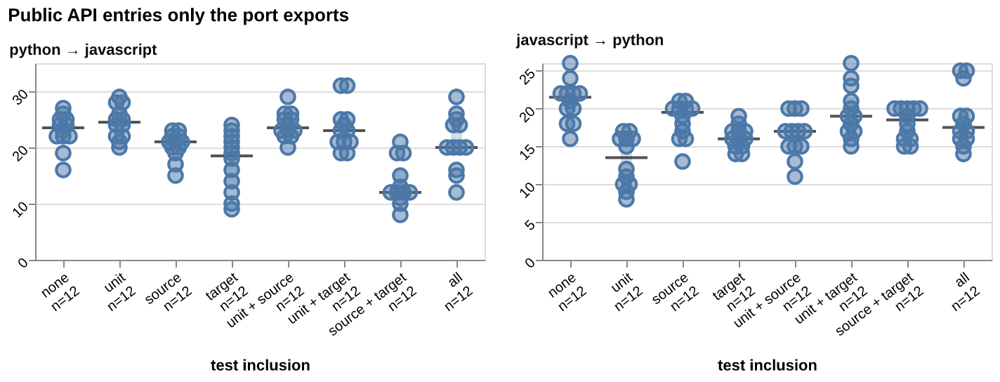

Count of exported names (with parameter count) the port has and the reference lacks. Dots: ports; tick: median; bar: IQR; panels: source language.

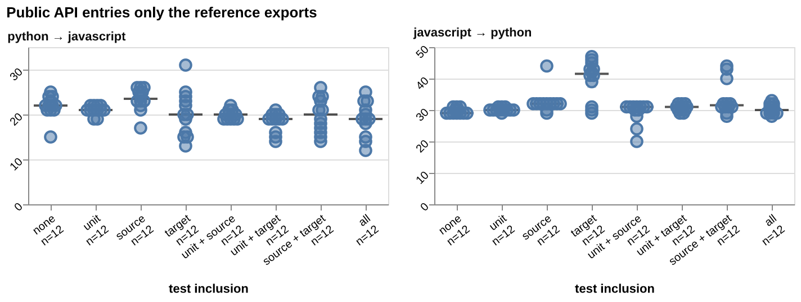

Count of exported names (with parameter count) the reference has and the port lacks. Dots: ports; tick: median; bar: IQR; panels: source language.

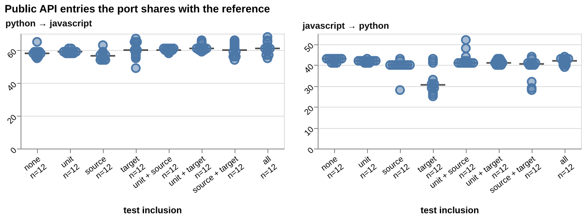

Count of exported names (with parameter count) present on both sides. Dots: ports; tick: median; bar: IQR; panels: source language.

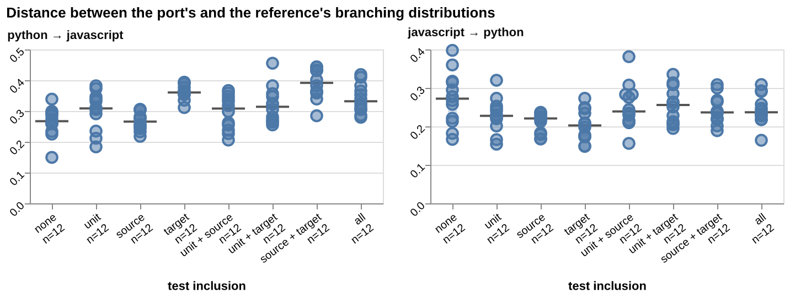

How far apart the two sides' spreads of per-function branch counts are (Wasserstein distance; 0 same spread). Dots: ports; tick: median; bar: IQR; panels: source language.

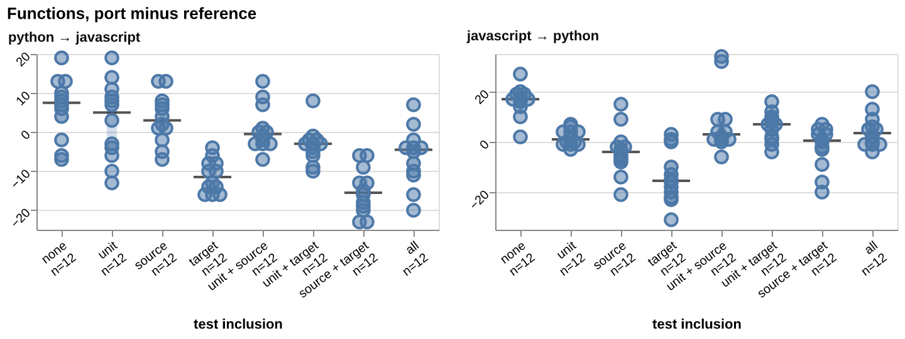

Port's function count minus the reference's; 0 equal count. Dots: ports; tick: median; bar: IQR; panels: source language.

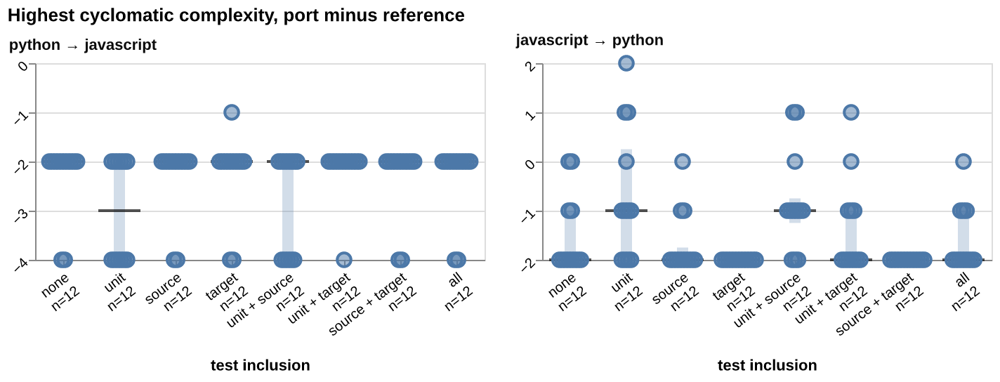

Highest cyclomatic complexity (1 plus a function's branch count) in the port minus that in the reference. Dots: ports; tick: median; bar: IQR; panels: source language.

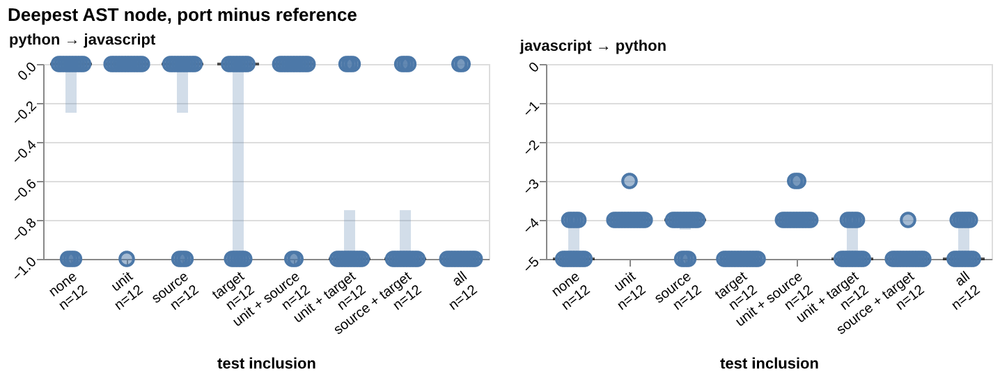

Deepest syntax-tree nesting in the port minus that in the reference. Dots: ports; tick: median; bar: IQR; panels: source language.

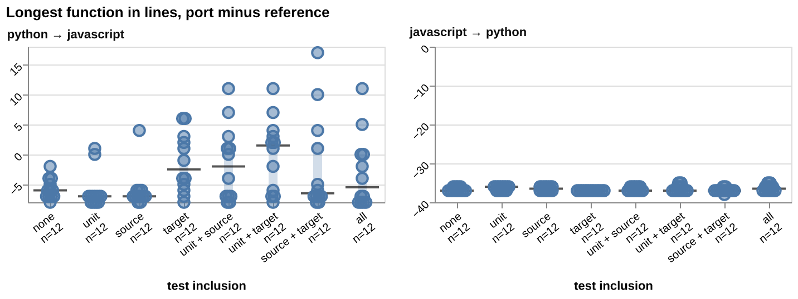

Lines of the port's longest function minus lines of the reference's longest. Dots: ports; tick: median; bar: IQR; panels: source language.

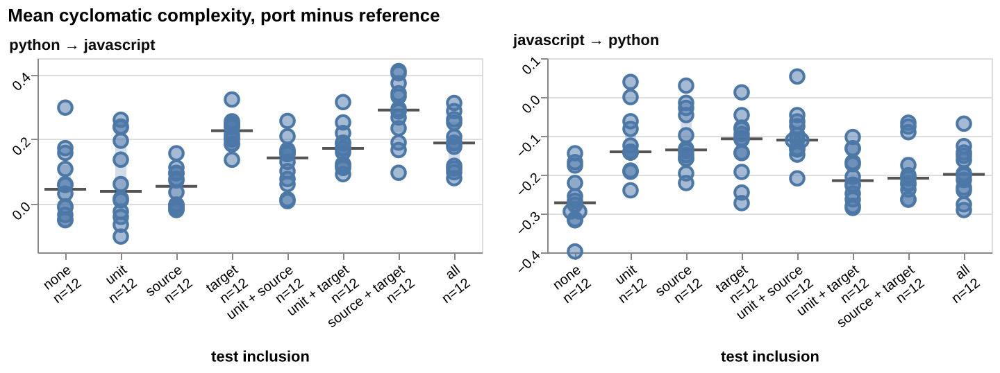

Mean cyclomatic complexity (1 plus a function's branch count) in the port minus that in the reference. Dots: ports; tick: median; bar: IQR; panels: source language.

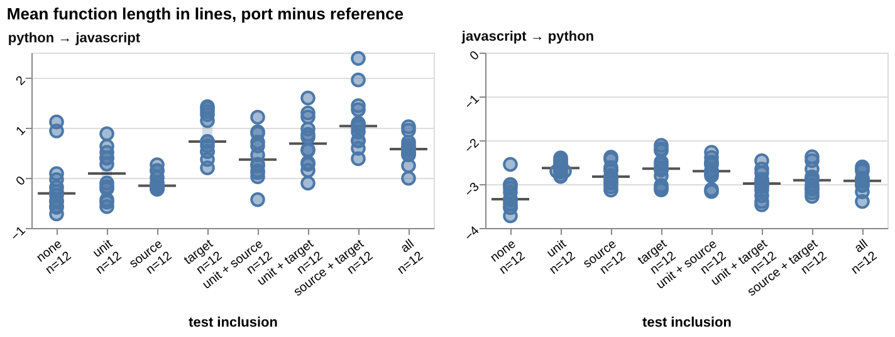

Mean lines per function in the port minus that in the reference. Dots: ports; tick: median; bar: IQR; panels: source language.

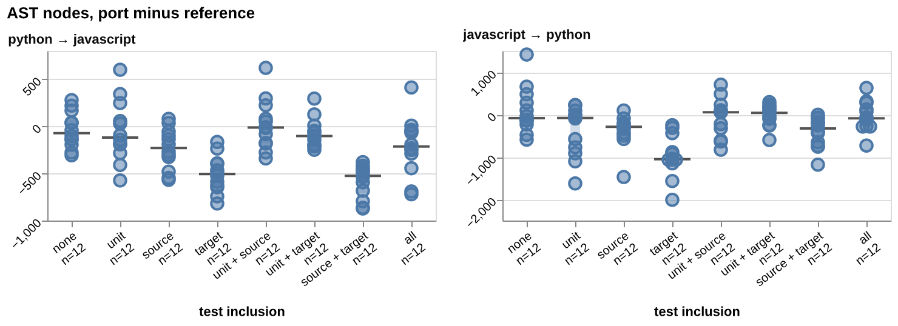

Syntax-tree nodes in the port minus nodes in the reference; a size measure. Dots: ports; tick: median; bar: IQR; panels: source language.

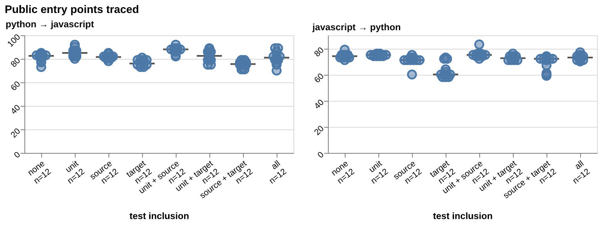

Count of shared public functions and class methods from which call paths are traced. Dots: ports; tick: median; bar: IQR; panels: source language.

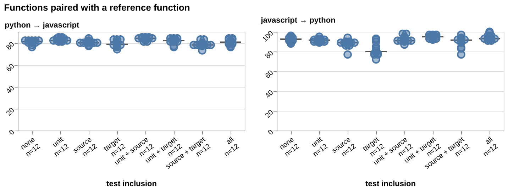

Count of functions paired across sides by name and parameter count. Dots: ports; tick: median; bar: IQR; panels: source language.


Paired functions over the reference's named functions; 1 every reference function has a partner. Dots: ports; tick: median; bar: IQR; panels: source language.

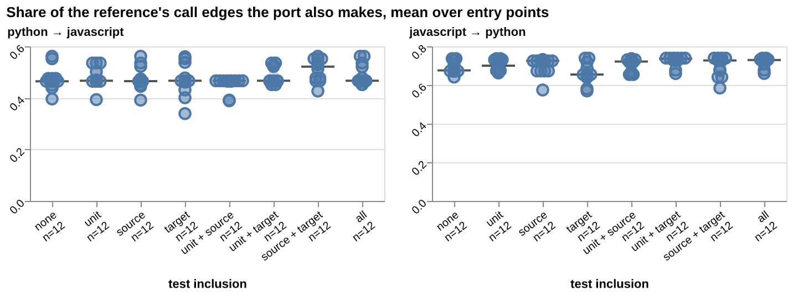

Per entry point, the share of the reference's caller→callee links present in the port, averaged over entry points; 1 all present. Dots: ports; tick: median; bar: IQR; panels: source language.

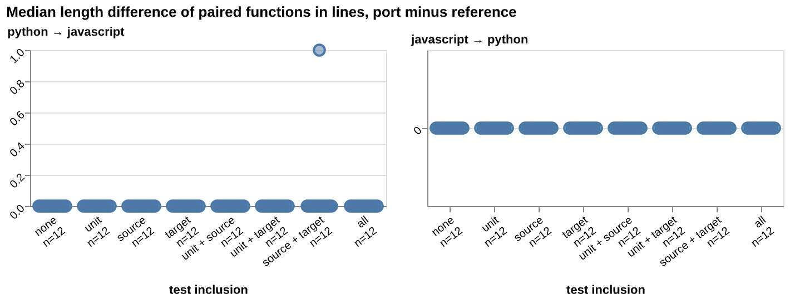

Median over paired functions of port lines minus reference lines; 0 same length. Dots: ports; tick: median; bar: IQR; panels: source language.

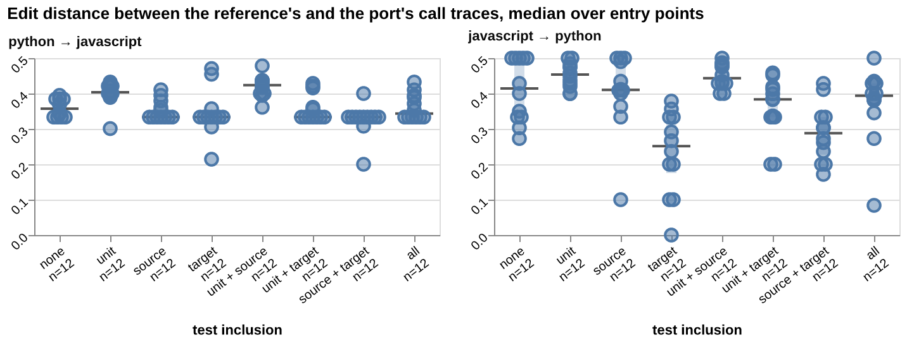

Edit distance between the orders in which each side visits functions from an entry point, over the longer order, median over entry points; 0 same order, 1 entirely different. Dots: ports; tick: median; bar: IQR; panels: source language.

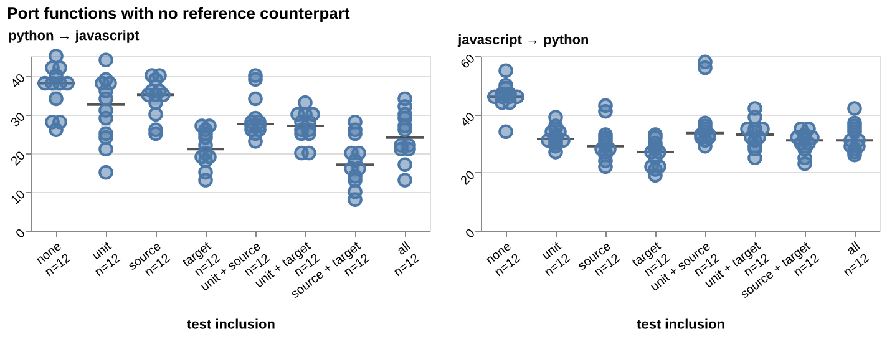

Count of port functions no reference function pairs with. Dots: ports; tick: median; bar: IQR; panels: source language.

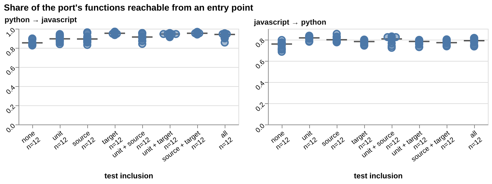

Port functions some shared entry point calls, directly or indirectly, over all port functions. Dots: ports; tick: median; bar: IQR; panels: source language.

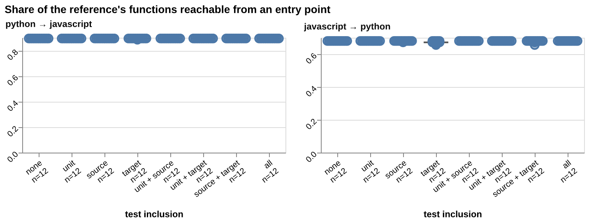

Reference functions some shared entry point calls, directly or indirectly, over all reference functions. Dots: ports; tick: median; bar: IQR; panels: source language.

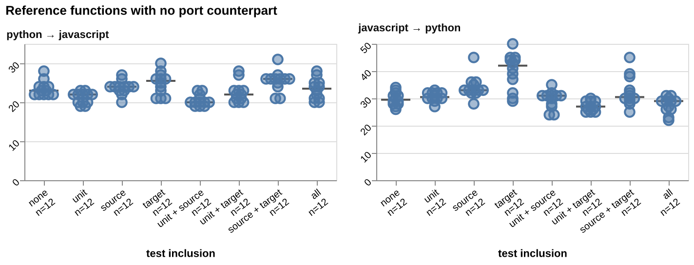

Count of reference functions no port function pairs with. Dots: ports; tick: median; bar: IQR; panels: source language.

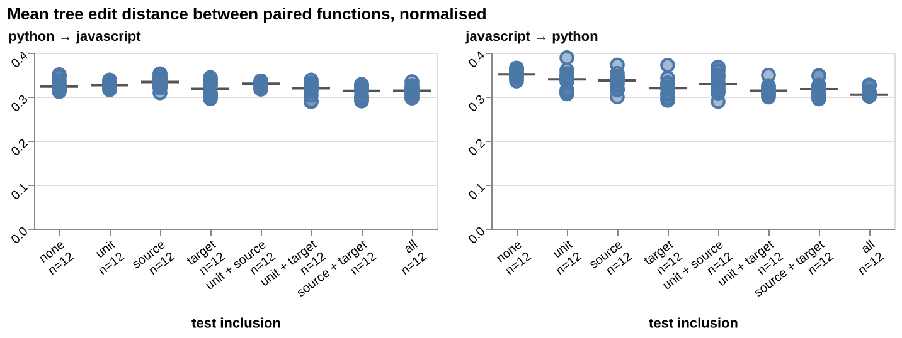

Tree edit distance over the larger tree's size, mean over paired functions; 0 same shape, 1 nothing shared. Dots: ports; tick: median; bar: IQR; panels: source language.


Tree edit distance over the larger tree's size, median over paired functions; 0 same shape, 1 nothing shared. Dots: ports; tick: median; bar: IQR; panels: source language.

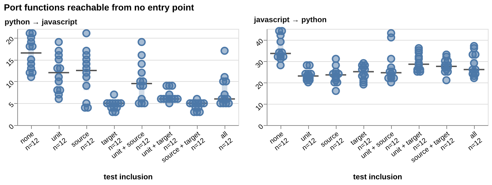

Count of port functions no shared entry point calls, directly or indirectly. Dots: ports; tick: median; bar: IQR; panels: source language.

Median [25th, 75th percentile] per condition, from the notebook; n counts successful ports.

| Source | Given tests | n | Reference functions paired (share) | Paired tree distance | Branching distribution distance |
| --- | --- | --- | --- | --- | --- |
| python | none | 12 | 0.78 [0.77, 0.79] | 0.26 [0.25, 0.28] | 0.27 [0.25, 0.29] |
| python | unit | 12 | 0.79 [0.79, 0.81] | 0.26 [0.25, 0.28] | 0.31 [0.28, 0.34] |
| python | source | 12 | 0.77 [0.77, 0.78] | 0.28 [0.26, 0.3] | 0.27 [0.25, 0.29] |
| python | target | 12 | 0.75 [0.75, 0.78] | 0.26 [0.24, 0.28] | 0.36 [0.35, 0.38] |
| python | unit + source | 12 | 0.81 [0.8, 0.81] | 0.27 [0.26, 0.28] | 0.31 [0.25, 0.34] |
| python | unit + target | 12 | 0.79 [0.78, 0.8] | 0.25 [0.25, 0.27] | 0.31 [0.27, 0.35] |
| python | source + target | 12 | 0.75 [0.75, 0.76] | 0.25 [0.24, 0.26] | 0.39 [0.36, 0.43] |
| python | all | 12 | 0.77 [0.76, 0.8] | 0.25 [0.25, 0.26] | 0.33 [0.31, 0.37] |
| javascript | none | 12 | 0.76 [0.74, 0.77] | 0.35 [0.33, 0.35] | 0.27 [0.22, 0.32] |
| javascript | unit | 12 | 0.75 [0.74, 0.75] | 0.33 [0.29, 0.34] | 0.23 [0.22, 0.25] |
| javascript | source | 12 | 0.73 [0.71, 0.73] | 0.33 [0.32, 0.34] | 0.22 [0.18, 0.23] |
| javascript | target | 12 | 0.66 [0.64, 0.71] | 0.32 [0.29, 0.34] | 0.2 [0.17, 0.24] |
| javascript | unit + source | 12 | 0.75 [0.75, 0.77] | 0.34 [0.3, 0.35] | 0.24 [0.21, 0.28] |
| javascript | unit + target | 12 | 0.78 [0.76, 0.79] | 0.31 [0.3, 0.32] | 0.26 [0.21, 0.29] |
| javascript | source + target | 12 | 0.75 [0.72, 0.76] | 0.31 [0.28, 0.32] | 0.24 [0.22, 0.27] |
| javascript | all | 12 | 0.76 [0.76, 0.79] | 0.3 [0.29, 0.31] | 0.24 [0.22, 0.27] |

Median [25th, 75th percentile] per condition, from the notebook; n counts successful ports.

| Source | Given tests | n | Reference call edges retained (mean share) | Call-trace distance (median) |
| --- | --- | --- | --- | --- |
| python | none | 12 | 0.46 [0.46, 0.48] | 0.36 [0.33, 0.38] |
| python | unit | 12 | 0.47 [0.46, 0.51] | 0.4 [0.39, 0.42] |
| python | source | 12 | 0.46 [0.46, 0.49] | 0.33 [0.33, 0.37] |
| python | target | 12 | 0.47 [0.45, 0.49] | 0.33 [0.33, 0.34] |
| python | unit + source | 12 | 0.47 [0.46, 0.47] | 0.42 [0.4, 0.44] |
| python | unit + target | 12 | 0.47 [0.46, 0.52] | 0.33 [0.33, 0.37] |
| python | source + target | 12 | 0.52 [0.47, 0.55] | 0.33 [0.33, 0.33] |
| python | all | 12 | 0.47 [0.46, 0.52] | 0.34 [0.33, 0.39] |
| javascript | none | 12 | 0.68 [0.67, 0.73] | 0.41 [0.33, 0.5] |
| javascript | unit | 12 | 0.7 [0.67, 0.73] | 0.45 [0.43, 0.48] |
| javascript | source | 12 | 0.72 [0.67, 0.72] | 0.41 [0.39, 0.49] |
| javascript | target | 12 | 0.65 [0.65, 0.7] | 0.25 [0.18, 0.33] |
| javascript | unit + source | 12 | 0.72 [0.66, 0.73] | 0.44 [0.43, 0.48] |
| javascript | unit + target | 12 | 0.74 [0.73, 0.74] | 0.38 [0.33, 0.41] |
| javascript | source + target | 12 | 0.73 [0.67, 0.74] | 0.29 [0.23, 0.33] |
| javascript | all | 12 | 0.73 [0.71, 0.73] | 0.39 [0.37, 0.43] |

## Does including tests change how the agent reads the reference?

**Why.** Counted, per run, from the transcript (subagents included): files read, in order. A read is a Read call or a reading shell command (`cat`, `head`, `grep`, ...); each file is classed as source code, source-language tests, target-language tests, the port, or other. Measures: reads per class; distinct files read before the first write into the port; rereads (reads of a file already read) and the most rereads of one file; Glob and Grep calls per distinct file read; reads after the last write; the class of the first file read; whether the first source file read is the package's entry point; and whether the run touched each supplied suite at all. High means more reading or rereading; low means less; no dot means the event never happened (for example, no write). Hypothesis: unit and source integration tests raise reads of source-language tests; target integration tests raise reads of target-language tests; any given suite raises reading before the first write. A difference would show the given tests changed what the agent did; it would not show understanding or a better strategy, and reads the parser cannot recognise are missed (a recursive grep of a directory counts as one read). Why it matters: reading is the route by which tests could reach the port. [Measure definition](https://github.com/thekevinscott/ports-research/blob/8999c36b8d8ed765f20682fc54f9799a317750ad/analysis/measure-transcript/README.md).


Distinct files read before the agent first writes into the port. Dots: ports; tick: median; bar: IQR; panels: source language.


Rereads of the single most reread file. Dots: ports; tick: median; bar: IQR; panels: source language.


Reads of files in the source language's shipped test suites. Dots: ports; tick: median; bar: IQR; panels: source language.


Reads of source-language files other than its tests. Dots: ports; tick: median; bar: IQR; panels: source language.


Reads of files in the target language's shipped integration tests. Dots: ports; tick: median; bar: IQR; panels: source language.


Reads after the agent's last write into the port. Dots: ports; tick: median; bar: IQR; panels: source language.


Reads of a file already read earlier in the run. Dots: ports; tick: median; bar: IQR; panels: source language.


Glob and Grep calls over distinct files read. Dots: ports; tick: median; bar: IQR; panels: source language.


Distinct source-language files read before the agent first writes into the port. Dots: ports; tick: median; bar: IQR; panels: source language.

Median [25th, 75th percentile] per condition, from the notebook; n counts successful ports.

| Source | Given tests | n | Source-test reads | Target-test reads | Paths read before first write | Rereads |
| --- | --- | --- | --- | --- | --- | --- |
| python | none | 12 | 0.0 [0.0, 0.0] | 0.0 [0.0, 0.0] | 40.0 [39.75, 40.0] | 0.0 [0.0, 1.25] |
| python | unit | 12 | 5.0 [3.75, 6.0] | 0.0 [0.0, 0.0] | 61.5 [61.0, 62.25] | 10.5 [7.25, 13.25] |
| python | source | 12 | 3.5 [3.0, 4.0] | 0.0 [0.0, 0.0] | 44.0 [43.0, 44.0] | 7.0 [5.75, 10.25] |
| python | target | 12 | 0.0 [0.0, 0.0] | 4.0 [3.0, 4.0] | 47.0 [46.0, 47.25] | 6.0 [5.5, 7.25] |
| python | unit + source | 12 | 7.0 [6.0, 8.25] | 0.0 [0.0, 0.0] | 67.5 [63.0, 69.0] | 15.0 [10.75, 19.75] |
| python | unit + target | 12 | 9.0 [7.75, 10.5] | 3.0 [2.0, 4.0] | 57.5 [51.5, 72.0] | 39.5 [31.75, 50.25] |
| python | source + target | 12 | 1.0 [0.75, 1.0] | 4.0 [3.0, 5.0] | 47.0 [16.75, 48.25] | 9.0 [7.0, 10.25] |
| python | all | 12 | 9.0 [8.0, 11.0] | 3.5 [3.0, 4.0] | 66.5 [51.75, 70.0] | 40.5 [28.0, 46.25] |
| javascript | none | 12 | 0.0 [0.0, 0.0] | 0.0 [0.0, 0.0] | 24.0 [8.0, 38.25] | 0.0 [0.0, 0.25] |
| javascript | unit | 12 | 4.5 [3.0, 6.0] | 0.0 [0.0, 0.0] | 21.0 [10.0, 31.0] | 7.0 [6.0, 11.25] |
| javascript | source | 12 | 4.5 [4.0, 5.0] | 0.0 [0.0, 0.0] | 43.0 [42.0, 44.0] | 10.5 [7.75, 14.25] |
| javascript | target | 12 | 0.0 [0.0, 0.0] | 3.0 [3.0, 4.0] | 41.0 [40.75, 42.25] | 9.5 [6.0, 11.0] |
| javascript | unit + source | 12 | 11.0 [9.75, 14.0] | 0.0 [0.0, 0.0] | 59.5 [52.0, 67.5] | 20.0 [12.0, 41.0] |
| javascript | unit + target | 12 | 9.0 [7.75, 10.25] | 3.5 [3.0, 4.0] | 46.0 [36.5, 54.25] | 29.5 [24.0, 39.5] |
| javascript | source + target | 12 | 2.0 [1.0, 2.0] | 3.0 [3.0, 4.0] | 43.0 [42.5, 44.0] | 9.0 [8.0, 14.5] |
| javascript | all | 12 | 10.5 [9.0, 12.0] | 3.5 [3.0, 4.25] | 50.5 [45.25, 64.5] | 39.5 [29.5, 54.25] |

Runs per condition, from the notebook: the first three columns classify the first source code file read; the rest classify the first file read of any kind.

| Source | Given tests | Runs | Entry point first | Other source code first | No source code read | First read: source | First read: source tests | First read: target tests | First read: port | First read: other |
| --- | --- | --- | --- | --- | --- | --- | --- | --- | --- | --- |
| python | none | 12 | 2 | 10 | 0 | 1 | 0 | 0 | 0 | 11 |
| python | unit | 12 | 1 | 10 | 1 | 10 | 0 | 0 | 0 | 2 |
| python | source | 12 | 7 | 4 | 1 | 12 | 0 | 0 | 0 | 0 |
| python | target | 12 | 5 | 5 | 2 | 0 | 0 | 0 | 0 | 12 |
| python | unit + source | 12 | 1 | 11 | 0 | 6 | 0 | 0 | 0 | 6 |
| python | unit + target | 12 | 4 | 8 | 0 | 0 | 0 | 0 | 0 | 12 |
| python | source + target | 12 | 3 | 5 | 4 | 0 | 0 | 0 | 0 | 12 |
| python | all | 12 | 7 | 4 | 1 | 0 | 0 | 0 | 0 | 12 |
| javascript | none | 12 | 1 | 10 | 1 | 0 | 0 | 0 | 0 | 12 |
| javascript | unit | 12 | 0 | 3 | 9 | 1 | 0 | 0 | 0 | 11 |
| javascript | source | 12 | 2 | 10 | 0 | 0 | 0 | 0 | 0 | 12 |
| javascript | target | 12 | 5 | 5 | 2 | 0 | 0 | 0 | 0 | 12 |
| javascript | unit + source | 12 | 4 | 8 | 0 | 0 | 0 | 0 | 0 | 12 |
| javascript | unit + target | 12 | 2 | 10 | 0 | 2 | 0 | 0 | 0 | 10 |
| javascript | source + target | 12 | 7 | 3 | 2 | 0 | 0 | 0 | 0 | 12 |
| javascript | all | 12 | 5 | 7 | 0 | 1 | 0 | 0 | 0 | 11 |

Runs per condition that touched each supplied suite (read, wrote, edited, searched, named in a shell command, or ran it) or contained a script running both the source and the port (differential script).

| Source | Given tests | Runs | Touched source tests | Touched target tests | Differential script |
| --- | --- | --- | --- | --- | --- |
| python | none | 12 | 0 | 0 | 6 |
| python | unit | 12 | 12 | 0 | 4 |
| python | source | 12 | 12 | 0 | 5 |
| python | target | 12 | 0 | 12 | 1 |
| python | unit + source | 12 | 12 | 0 | 3 |
| python | unit + target | 12 | 12 | 12 | 4 |
| python | source + target | 12 | 11 | 12 | 1 |
| python | all | 12 | 12 | 12 | 4 |
| javascript | none | 12 | 7 | 0 | 7 |
| javascript | unit | 12 | 12 | 0 | 11 |
| javascript | source | 12 | 12 | 0 | 11 |
| javascript | target | 12 | 0 | 12 | 4 |
| javascript | unit + source | 12 | 12 | 0 | 12 |
| javascript | unit + target | 12 | 12 | 12 | 10 |
| javascript | source + target | 12 | 12 | 12 | 11 |
| javascript | all | 12 | 12 | 12 | 11 |

## Does including tests change how much work the port takes?

**Why.** Counted, per run: tokens before the first write into the port and from it on (input, output and cache tokens summed); assistant turns; calls per tool; network fetch or install attempts; the turn of the first write and of the last test run; test-suite runs; test files the agent wrote itself; and passed and failed counts from the last run of each suite. High means more activity; low means less; no dot means the event did not occur or no test summary was readable (not zero tests). Hypothesis: any given suite adds reading and test runs, raising these counts; target integration tests may lower tokens and turns by making the required interface explicit. A difference would show the given tests changed the effort spent; it would not show productivity or port quality. Why it matters: tests may cost effort even where they change nothing else. Total tokens, model calls and wall time have no per-condition chart; total tokens is in the table below and all three are in the statistics section.


Bash tool calls. Dots: ports; tick: median; bar: IQR; panels: source language.


Edit tool calls. Dots: ports; tick: median; bar: IQR; panels: source language.


WebFetch and WebSearch calls plus `curl`, `wget`, `pip install` and `npm install` commands. Dots: ports; tick: median; bar: IQR; panels: source language.


Assistant turn at which the agent first writes into the port. Dots: ports; tick: median; bar: IQR; panels: source language.


Tests reported failed by the last run of the agent's own tests; no dot when no run or no readable summary. Dots: ports; tick: median; bar: IQR; panels: source language.


Tests reported passed by the last run of the agent's own tests; no dot when no run or no readable summary. Dots: ports; tick: median; bar: IQR; panels: source language.


Tests reported failed by the last run of the source language's tests; no dot when no run or no readable summary. Dots: ports; tick: median; bar: IQR; panels: source language.


Tests reported passed by the last run of the source language's tests; no dot when no run or no readable summary. Dots: ports; tick: median; bar: IQR; panels: source language.


Assistant turn of the last test-suite run. Dots: ports; tick: median; bar: IQR; panels: source language.


Tests reported failed by the last run of the target language's tests; no dot when no run or no readable summary. Dots: ports; tick: median; bar: IQR; panels: source language.


Tests reported passed by the last run of the target language's tests; no dot when no run or no readable summary. Dots: ports; tick: median; bar: IQR; panels: source language.


Tests reported failed by the last test run covering more than one of source tests, target tests and own tests; no dot when no run or no readable summary. Dots: ports; tick: median; bar: IQR; panels: source language.


Tests reported passed by the last test run covering more than one of source tests, target tests and own tests; no dot when no run or no readable summary. Dots: ports; tick: median; bar: IQR; panels: source language.


Test files written into the port that were not copied from the supplied suites. Dots: ports; tick: median; bar: IQR; panels: source language.


Read tool calls (shell reads such as `cat` are not included). Dots: ports; tick: median; bar: IQR; panels: source language.


Glob and Grep tool calls. Dots: ports; tick: median; bar: IQR; panels: source language.


Runs of pytest, vitest, jest, `node --test` or a package test script. Dots: ports; tick: median; bar: IQR; panels: source language.


Input, output and cache tokens summed over turns from the first write on. Dots: ports; tick: median; bar: IQR; panels: source language.


Input, output and cache tokens summed over turns before the first write. Dots: ports; tick: median; bar: IQR; panels: source language.


Assistant messages in the run. Dots: ports; tick: median; bar: IQR; panels: source language.


Write tool calls. Dots: ports; tick: median; bar: IQR; panels: source language.

Median [25th, 75th percentile] per condition, from the notebook; n counts successful ports.

| Source | Given tests | n | Total tokens | Suite runs | Own test files |
| --- | --- | --- | --- | --- | --- |
| python | none | 12 | 1112026.5 [1040397.75, 1285314.75] | 4.0 [2.75, 5.25] | 2.0 [1.0, 2.0] |
| python | unit | 12 | 2995979.5 [2734251.75, 3134006.75] | 10.0 [9.0, 11.25] | 24.0 [23.0, 25.0] |
| python | source | 12 | 1360515.5 [1296947.5, 1496816.75] | 4.5 [3.75, 6.0] | 1.0 [0.75, 6.0] |
| python | target | 12 | 1073723.5 [967378.25, 1178212.5] | 4.0 [3.75, 4.0] | 1.0 [0.0, 1.0] |
| python | unit + source | 12 | 3236537.5 [2919203.0, 3585524.25] | 9.0 [7.75, 10.0] | 22.5 [21.75, 23.25] |
| python | unit + target | 12 | 2842488.5 [2792119.25, 2941703.25] | 10.0 [9.0, 11.0] | 22.0 [21.0, 22.25] |
| python | source + target | 12 | 1072875.5 [976667.75, 1190370.25] | 3.0 [2.75, 4.0] | 0.0 [0.0, 1.0] |
| python | all | 12 | 2716913.5 [2565081.5, 2971104.25] | 11.0 [8.0, 12.0] | 22.0 [21.0, 22.0] |
| javascript | none | 12 | 1474019.0 [1417619.0, 1623198.0] | 8.0 [5.75, 10.25] | 1.0 [1.0, 1.25] |
| javascript | unit | 12 | 2457313.5 [2235225.5, 2843651.0] | 4.0 [3.75, 6.5] | 7.0 [6.0, 14.5] |
| javascript | source | 12 | 1595021.5 [1529789.25, 1846382.5] | 3.0 [2.0, 3.75] | 0.5 [0.0, 6.25] |
| javascript | target | 12 | 842847.5 [809326.0, 936980.75] | 3.0 [1.75, 4.0] | 0.0 [0.0, 0.0] |
| javascript | unit + source | 12 | 3287713.0 [2679757.5, 4080672.25] | 7.5 [5.75, 9.5] | 22.0 [11.25, 25.0] |
| javascript | unit + target | 12 | 2869219.5 [2621371.25, 3354633.75] | 10.5 [9.0, 12.25] | 23.0 [23.0, 24.0] |
| javascript | source + target | 12 | 1254455.5 [1188150.0, 1543225.0] | 3.0 [2.75, 4.0] | 1.0 [0.75, 1.0] |
| javascript | all | 12 | 3085734.5 [2993864.0, 3363053.0] | 10.0 [10.0, 11.0] | 23.0 [23.0, 24.0] |

All attempts per condition, failed ones included, from the notebook; tokens per success is all attempts' tokens over successful ports; API errors counts attempts whose result records `api_error`.

| Source | Given tests | Attempts | Exit 0 | Exit 137 | API errors | Tokens per success |
| --- | --- | --- | --- | --- | --- | --- |
| python | none | 16 | 12 | 0 | 4 | 1141352.83 |
| python | unit | 16 | 12 | 0 | 4 | 2904434.75 |
| python | source | 16 | 12 | 0 | 4 | 1385997.33 |
| python | target | 16 | 12 | 0 | 4 | 1092986.75 |
| python | unit + source | 17 | 12 | 0 | 5 | 3303547.25 |
| python | unit + target | 17 | 12 | 0 | 5 | 3105329.83 |
| python | source + target | 16 | 12 | 0 | 4 | 1105363.25 |
| python | all | 16 | 12 | 0 | 4 | 2791548.33 |
| javascript | none | 20 | 12 | 3 | 5 | 1778007.67 |
| javascript | unit | 16 | 12 | 0 | 4 | 2485619.83 |
| javascript | source | 19 | 12 | 3 | 4 | 2068407.75 |
| javascript | target | 16 | 12 | 0 | 4 | 948710.92 |
| javascript | unit + source | 16 | 12 | 0 | 4 | 3405525.92 |
| javascript | unit + target | 16 | 12 | 0 | 4 | 3047596.33 |
| javascript | source + target | 17 | 12 | 1 | 4 | 1568387.33 |
| javascript | all | 17 | 12 | 1 | 4 | 3374072 |

## Does including tests change the port's similarity in embedding space?

**Why.** Would count: each code file embedded as a vector; for a port and the reference, or two ports, each file's distance to its nearest file on the other side, averaged with longer files weighted more. Low distance means the code reads alike to the embedding model; high means it does not. Hypothesis: unit and source integration tests constrain implementation choices, lowering distance between ports given the same suites; target integration tests do the same for interface code. A difference would concern this model's representation only; it would not show agreement in behaviour or correctness. Why it matters: it is a whole-codebase similarity that needs no hand-written comparison rules.

**No V2 embedding charts exist.** The notebook's embedding charts select V1 runs only, so `export_charts.py` produced none for this study. The separate [embedding-pair export](https://github.com/thekevinscott/ports-research/blob/8999c36b8d8ed765f20682fc54f9799a317750ad/analysis/notebook/export_embedding_pairs.py), also V1 only, failed: `compare_corpus → validate_cache → ValueError: cached file selection differs from source` for the Python reference.

## Which differences are larger than chance?

**Why.** For each lead measure and each flag, runs with the flag on are compared with runs with it off, pooled over both source languages and within each. `gap` is the on median minus the off median: positive means the on runs' median is higher, negative lower, near zero alike. `p` is the share of 10,000 random reshuffles of the on/off labels (seed 0) giving a gap at least as far from zero; small p means few reshuffles do. `low` to `high` is a 95% bootstrap interval on the gap (10,000 resamples, seed 0); wide means imprecise. `minimum_detectable_gap` is the smallest gap the same reshuffles could give p < 0.05 at this n; a row with p ≥ 0.05 reads as a gap too small to see at this n, never as no effect. Spearman ρ ranks runs on two measures and asks whether the orders agree: +1 same order, −1 reverse, 0 unrelated. Hypothesis: each flag moves its measures in the directions stated in the sections above, and structure and process measures that track held-out agreement rank with it. A small p flags a gap for review; it does not establish a mechanism, make a structural measure a stand-in for correctness, or, when large, show absence of an effect. Why it matters: this is the screen for which charts above deserve a closer look. The study is exploratory and runs many tests without correction, so these are screening numbers, not confirmations. Tables keep the notebook's rows, columns and rounding; `pooled` combines both directions.

### Held-out behaviour agreement with the reference (%)

| flag | source_language | n_on | n_off | median_on | median_off | gap | low | high | p | minimum_detectable_gap |
| --- | --- | --- | --- | --- | --- | --- | --- | --- | --- | --- |
| include_unit_tests | pooled | 96 | 96 | 97.5 | 97.5 | 0 | -1.88 | 0 | 1 | 0 |
| include_unit_tests | python | 48 | 48 | 97.5 | 97.5 | 0 | 0 | 0.63 | 1 | 0 |
| include_unit_tests | javascript | 48 | 48 | 99.37 | 99.37 | 0 | -59.57 | 0 | 1 | 1.25 |
| include_source_integration_tests | pooled | 96 | 96 | 97.5 | 97.5 | 0 | -11.39 | 0 | 1 | 0 |
| include_source_integration_tests | python | 48 | 48 | 97.5 | 97.5 | 0 | -0.63 | 0 | 1 | 0 |
| include_source_integration_tests | javascript | 48 | 48 | 99.37 | 99.37 | 0 | -59.57 | 0 | 1 | 1.25 |
| include_target_integration_tests | pooled | 96 | 96 | 97.5 | 39.8 | 57.7 | 28.22 | 59.57 | 0.0001 | 0 |
| include_target_integration_tests | python | 48 | 48 | 97.5 | 76.53 | 20.96 | 0 | 41.3 | 0.0005 | 0 |
| include_target_integration_tests | javascript | 48 | 48 | 99.37 | 39.8 | 59.57 | 59.57 | 99.37 | 0.0033 | 1.25 |

### Held-out API agreement with the reference (%)

| flag | source_language | n_on | n_off | median_on | median_off | gap | low | high | p | minimum_detectable_gap |
| --- | --- | --- | --- | --- | --- | --- | --- | --- | --- | --- |
| include_unit_tests | pooled | 96 | 96 | 87.79 | 87.79 | 0 | -7.11 | 0 | 1 | 0 |
| include_unit_tests | python | 48 | 48 | 87.79 | 87.79 | 0 | 0 | 2.2 | 1 | 0 |
| include_unit_tests | javascript | 48 | 48 | 94.89 | 94.89 | 0 | -85.89 | 0 | 1 | 5.41 |
| include_source_integration_tests | pooled | 96 | 96 | 87.79 | 87.79 | 0 | -40.49 | 0 | 1 | 0 |
| include_source_integration_tests | python | 48 | 48 | 87.79 | 87.79 | 0 | -2.2 | 0.75 | 1 | 0 |
| include_source_integration_tests | javascript | 48 | 48 | 94.89 | 94.89 | 0 | -85.89 | 0 | 1 | 5.41 |
| include_target_integration_tests | pooled | 96 | 96 | 91.34 | 9.01 | 82.33 | 78.23 | 85.89 | 0.0001 | 0 |
| include_target_integration_tests | python | 48 | 48 | 87.79 | 48.05 | 39.74 | 0 | 77.28 | 0.0005 | 0 |
| include_target_integration_tests | javascript | 48 | 48 | 94.89 | 9.01 | 85.89 | 85.89 | 85.89 | 0.0119 | 5.41 |

### Share of the reference's functions the port has a counterpart for

| flag | source_language | n_on | n_off | median_on | median_off | gap | low | high | p | minimum_detectable_gap |
| --- | --- | --- | --- | --- | --- | --- | --- | --- | --- | --- |
| include_unit_tests | pooled | 96 | 96 | 0.78 | 0.75 | 0.03 | 0.02 | 0.04 | 0.0001 | 0.01 |
| include_unit_tests | python | 48 | 48 | 0.79 | 0.77 | 0.02 | 0.02 | 0.04 | 0.0334 | 0.01 |
| include_unit_tests | javascript | 48 | 48 | 0.76 | 0.73 | 0.03 | 0.01 | 0.04 | 0.0001 | 0.01 |
| include_source_integration_tests | pooled | 96 | 96 | 0.76 | 0.77 | -0.01 | -0.02 | 0.01 | 0.7745 | 0.01 |
| include_source_integration_tests | python | 48 | 48 | 0.77 | 0.79 | -0.01 | -0.02 | 0 | 0.0796 | 0.01 |
| include_source_integration_tests | javascript | 48 | 48 | 0.75 | 0.75 | -0.01 | -0.02 | 0.01 | 0.6851 | 0.01 |
| include_target_integration_tests | pooled | 96 | 96 | 0.76 | 0.77 | -0.01 | -0.02 | 0.01 | 0.7755 | 0.01 |
| include_target_integration_tests | python | 48 | 48 | 0.77 | 0.79 | -0.02 | -0.03 | 0 | 0.0331 | 0.01 |
| include_target_integration_tests | javascript | 48 | 48 | 0.76 | 0.75 | 0.01 | 0 | 0.02 | 0.0523 | 0.01 |

### Shape difference of paired functions (median)

| flag | source_language | n_on | n_off | median_on | median_off | gap | low | high | p | minimum_detectable_gap |
| --- | --- | --- | --- | --- | --- | --- | --- | --- | --- | --- |
| include_unit_tests | pooled | 96 | 96 | 0.28 | 0.29 | -0.01 | -0.03 | 0.01 | 0.1813 | 0.02 |
| include_unit_tests | python | 48 | 48 | 0.26 | 0.26 | 0 | -0.01 | 0.01 | 0.8939 | 0.01 |
| include_unit_tests | javascript | 48 | 48 | 0.31 | 0.33 | -0.02 | -0.04 | 0 | 0.0518 | 0.02 |
| include_source_integration_tests | pooled | 96 | 96 | 0.29 | 0.29 | 0 | -0.02 | 0.01 | 0.6752 | 0.02 |
| include_source_integration_tests | python | 48 | 48 | 0.26 | 0.26 | 0 | -0.01 | 0.01 | 0.8434 | 0.01 |
| include_source_integration_tests | javascript | 48 | 48 | 0.32 | 0.33 | -0.01 | -0.03 | 0 | 0.1397 | 0.02 |
| include_target_integration_tests | pooled | 96 | 96 | 0.28 | 0.3 | -0.01 | -0.04 | 0 | 0.0598 | 0.02 |
| include_target_integration_tests | python | 48 | 48 | 0.25 | 0.27 | -0.02 | -0.02 | -0.01 | 0.0021 | 0.01 |
| include_target_integration_tests | javascript | 48 | 48 | 0.3 | 0.34 | -0.04 | -0.04 | -0.02 | 0.0001 | 0.02 |

### Difference in branching between port and reference

| flag | source_language | n_on | n_off | median_on | median_off | gap | low | high | p | minimum_detectable_gap |
| --- | --- | --- | --- | --- | --- | --- | --- | --- | --- | --- |
| include_unit_tests | pooled | 96 | 96 | 0.28 | 0.26 | 0.01 | -0.02 | 0.04 | 0.3559 | 0.03 |
| include_unit_tests | python | 48 | 48 | 0.32 | 0.31 | 0.01 | -0.05 | 0.04 | 0.792 | 0.03 |
| include_unit_tests | javascript | 48 | 48 | 0.24 | 0.22 | 0.01 | -0.01 | 0.03 | 0.0854 | 0.02 |
| include_source_integration_tests | pooled | 96 | 96 | 0.27 | 0.27 | -0.01 | -0.04 | 0.02 | 0.7854 | 0.03 |
| include_source_integration_tests | python | 48 | 48 | 0.32 | 0.31 | 0.01 | -0.03 | 0.04 | 0.8617 | 0.03 |
| include_source_integration_tests | javascript | 48 | 48 | 0.23 | 0.23 | 0 | -0.03 | 0.02 | 0.8974 | 0.02 |
| include_target_integration_tests | pooled | 96 | 96 | 0.29 | 0.26 | 0.03 | 0 | 0.07 | 0.0146 | 0.03 |
| include_target_integration_tests | python | 48 | 48 | 0.36 | 0.28 | 0.07 | 0.05 | 0.1 | 0.0001 | 0.03 |
| include_target_integration_tests | javascript | 48 | 48 | 0.23 | 0.23 | 0 | -0.02 | 0.02 | 0.7338 | 0.02 |

### Share of the reference's call links the port also makes

| flag | source_language | n_on | n_off | median_on | median_off | gap | low | high | p | minimum_detectable_gap |
| --- | --- | --- | --- | --- | --- | --- | --- | --- | --- | --- |
| include_unit_tests | pooled | 96 | 96 | 0.61 | 0.57 | 0.04 | -0.11 | 0.11 | 0.6448 | 0.12 |
| include_unit_tests | python | 48 | 48 | 0.47 | 0.47 | 0 | -0.01 | 0 | 1 | 0 |
| include_unit_tests | javascript | 48 | 48 | 0.73 | 0.68 | 0.05 | 0 | 0.06 | 0.0271 | 0.04 |
| include_source_integration_tests | pooled | 96 | 96 | 0.57 | 0.57 | 0 | -0.11 | 0.12 | 0.9988 | 0.12 |
| include_source_integration_tests | python | 48 | 48 | 0.47 | 0.47 | 0 | 0 | 0.01 | 1 | 0 |
| include_source_integration_tests | javascript | 48 | 48 | 0.72 | 0.7 | 0.03 | -0.01 | 0.05 | 0.1251 | 0.04 |
| include_target_integration_tests | pooled | 96 | 96 | 0.57 | 0.57 | 0 | -0.11 | 0.12 | 0.9979 | 0.12 |
| include_target_integration_tests | python | 48 | 48 | 0.47 | 0.47 | 0 | 0 | 0.05 | 1 | 0 |
| include_target_integration_tests | javascript | 48 | 48 | 0.73 | 0.72 | 0.01 | -0.02 | 0.06 | 0.372 | 0.04 |

### Difference in call order from each entry point

| flag | source_language | n_on | n_off | median_on | median_off | gap | low | high | p | minimum_detectable_gap |
| --- | --- | --- | --- | --- | --- | --- | --- | --- | --- | --- |
| include_unit_tests | pooled | 96 | 96 | 0.4 | 0.33 | 0.07 | 0.06 | 0.09 | 0.0005 | 0.04 |
| include_unit_tests | python | 48 | 48 | 0.4 | 0.33 | 0.06 | 0.03 | 0.08 | 0.0002 | 0.04 |
| include_unit_tests | javascript | 48 | 48 | 0.43 | 0.33 | 0.1 | 0.03 | 0.13 | 0.0001 | 0.04 |
| include_source_integration_tests | pooled | 96 | 96 | 0.38 | 0.37 | 0.01 | -0.03 | 0.05 | 0.5754 | 0.04 |
| include_source_integration_tests | python | 48 | 48 | 0.34 | 0.36 | -0.01 | -0.05 | 0.04 | 0.6858 | 0.04 |
| include_source_integration_tests | javascript | 48 | 48 | 0.4 | 0.39 | 0.01 | -0.02 | 0.08 | 0.3256 | 0.04 |
| include_target_integration_tests | pooled | 96 | 96 | 0.33 | 0.41 | -0.07 | -0.09 | -0.07 | 0.0001 | 0.04 |
| include_target_integration_tests | python | 48 | 48 | 0.33 | 0.39 | -0.06 | -0.07 | -0.04 | 0.0021 | 0.04 |
| include_target_integration_tests | javascript | 48 | 48 | 0.33 | 0.43 | -0.1 | -0.16 | -0.05 | 0.0001 | 0.04 |

### Total tokens

| flag | source_language | n_on | n_off | median_on | median_off | gap | low | high | p | minimum_detectable_gap |
| --- | --- | --- | --- | --- | --- | --- | --- | --- | --- | --- |
| include_unit_tests | pooled | 96 | 96 | 2944917.5 | 1236706 | 1708211.5 | 1576081 | 1843637.45 | 0.0001 | 884390 |
| include_unit_tests | python | 48 | 48 | 2908043 | 1131662 | 1776381 | 1603192.16 | 1887206 | 0.0001 | 1196819 |
| include_unit_tests | javascript | 48 | 48 | 2995255.5 | 1403736 | 1591519.5 | 1340403.5 | 1853011 | 0.0001 | 859816.5 |
| include_source_integration_tests | pooled | 96 | 96 | 2295962 | 1818696 | 477266 | -615016.3 | 1106226.08 | 0.4838 | 878610.5 |
| include_source_integration_tests | python | 48 | 48 | 1991383 | 1859621 | 131762 | -1150085.82 | 1313721 | 0.9124 | 1196256 |
| include_source_integration_tests | javascript | 48 | 48 | 2512115.5 | 1818696 | 693419.5 | -493707.67 | 1286513 | 0.171 | 861394.5 |
| include_target_integration_tests | pooled | 96 | 96 | 2190526 | 2016821.5 | 173704.5 | -955289 | 843075.12 | 0.8204 | 892343.5 |
| include_target_integration_tests | python | 48 | 48 | 1860776 | 1960712 | -99936 | -1456272.04 | 1079213.22 | 0.9336 | 1200375 |
| include_target_integration_tests | javascript | 48 | 48 | 2296659 | 2016821.5 | 279837.5 | -929054 | 1045305 | 0.6957 | 866518 |

### Lines of code in the port

| flag | source_language | n_on | n_off | median_on | median_off | gap | low | high | p | minimum_detectable_gap |
| --- | --- | --- | --- | --- | --- | --- | --- | --- | --- | --- |
| include_unit_tests | pooled | 96 | 96 | 996.5 | 966 | 30.5 | 12 | 63.5 | 0.0012 | 16 |
| include_unit_tests | python | 48 | 48 | 1000 | 967.5 | 32.5 | 10 | 69.01 | 0.0007 | 16.5 |
| include_unit_tests | javascript | 48 | 48 | 994 | 962 | 32 | -13 | 78 | 0.1441 | 40 |
| include_source_integration_tests | pooled | 96 | 96 | 982.5 | 978 | 4.5 | -15 | 21.5 | 0.7108 | 16 |
| include_source_integration_tests | python | 48 | 48 | 983 | 984 | -1 | -20.5 | 18 | 0.8603 | 16.5 |
| include_source_integration_tests | javascript | 48 | 48 | 978 | 971 | 7 | -30.5 | 53 | 0.7613 | 39.5 |
| include_target_integration_tests | pooled | 96 | 96 | 997 | 971 | 26 | 8.5 | 55 | 0.0023 | 16.5 |
| include_target_integration_tests | python | 48 | 48 | 984 | 980 | 4 | -18.5 | 22 | 0.5024 | 16.5 |
| include_target_integration_tests | javascript | 48 | 48 | 1017.5 | 941.5 | 76 | 41 | 102 | 0.0001 | 40 |

### Reads of the source language's tests

| flag | source_language | n_on | n_off | median_on | median_off | gap | low | high | p | minimum_detectable_gap |
| --- | --- | --- | --- | --- | --- | --- | --- | --- | --- | --- |
| include_unit_tests | pooled | 96 | 96 | 8 | 0 | 8 | 6.5 | 9 | 0.0001 | 2 |
| include_unit_tests | python | 48 | 48 | 7.5 | 0 | 7.5 | 6 | 9 | 0.0001 | 2.5 |
| include_unit_tests | javascript | 48 | 48 | 9 | 0.5 | 8.5 | 6.5 | 10 | 0.0001 | 3 |
| include_source_integration_tests | pooled | 96 | 96 | 5 | 0.5 | 4.5 | 1 | 7 | 0.0001 | 2 |
| include_source_integration_tests | python | 48 | 48 | 4.5 | 1 | 3.5 | -0.5 | 6 | 0.011 | 2.5 |
| include_source_integration_tests | javascript | 48 | 48 | 6.5 | 0.5 | 6 | 1.5 | 9 | 0.0001 | 3 |
| include_target_integration_tests | pooled | 96 | 96 | 3 | 4 | -1 | -3 | 3.5 | 0.3274 | 2 |
| include_target_integration_tests | python | 48 | 48 | 3 | 4 | -1 | -3.5 | 4 | 0.4638 | 2.5 |
| include_target_integration_tests | javascript | 48 | 48 | 3 | 4.5 | -1.5 | -3.5 | 4 | 0.4677 | 3 |

### Reads of the target language's tests

| flag | source_language | n_on | n_off | median_on | median_off | gap | low | high | p | minimum_detectable_gap |
| --- | --- | --- | --- | --- | --- | --- | --- | --- | --- | --- |
| include_unit_tests | pooled | 96 | 96 | 1 | 1 | 0 | -3 | 3 | 1 | 3 |
| include_unit_tests | python | 48 | 48 | 1 | 1 | 0 | -3 | 2.5 | 1 | 3 |
| include_unit_tests | javascript | 48 | 48 | 1 | 1 | 0 | -3 | 3 | 1 | 3 |
| include_source_integration_tests | pooled | 96 | 96 | 1 | 1 | 0 | -3 | 3 | 1 | 3 |
| include_source_integration_tests | python | 48 | 48 | 1 | 1 | 0 | -3 | 3 | 1 | 3 |
| include_source_integration_tests | javascript | 48 | 48 | 1 | 1 | 0 | -3 | 3 | 1 | 3 |
| include_target_integration_tests | pooled | 96 | 96 | 3 | 0 | 3 | 3 | 4 | 0.1096 | 3 |
| include_target_integration_tests | python | 48 | 48 | 4 | 0 | 4 | 3 | 4 | 0.0001 | 3 |
| include_target_integration_tests | javascript | 48 | 48 | 3 | 0 | 3 | 3 | 4 | 0.3095 | 3 |

### Test-suite runs

| flag | source_language | n_on | n_off | median_on | median_off | gap | low | high | p | minimum_detectable_gap |
| --- | --- | --- | --- | --- | --- | --- | --- | --- | --- | --- |
| include_unit_tests | pooled | 96 | 96 | 9.5 | 4 | 5.5 | 5 | 7 | 0.0001 | 2 |
| include_unit_tests | python | 48 | 48 | 10 | 4 | 6 | 5 | 7 | 0.0001 | 3 |
| include_unit_tests | javascript | 48 | 48 | 9 | 3 | 6 | 4 | 7 | 0.0001 | 2.5 |
| include_source_integration_tests | pooled | 96 | 96 | 6 | 6 | 0 | -3 | 2 | 1 | 2 |
| include_source_integration_tests | python | 48 | 48 | 6 | 6.5 | -0.5 | -3.5 | 2.5 | 1 | 3 |
| include_source_integration_tests | javascript | 48 | 48 | 5.5 | 6 | -0.5 | -3.5 | 2.5 | 0.9954 | 2.5 |
| include_target_integration_tests | pooled | 96 | 96 | 7 | 6 | 1 | -2 | 3 | 0.3534 | 2 |
| include_target_integration_tests | python | 48 | 48 | 7 | 6 | 1 | -4 | 3 | 0.7134 | 3 |
| include_target_integration_tests | javascript | 48 | 48 | 6 | 6 | 0 | -2.5 | 4 | 1 | 2.5 |

### Test files the agent wrote itself

| flag | source_language | n_on | n_off | median_on | median_off | gap | low | high | p | minimum_detectable_gap |
| --- | --- | --- | --- | --- | --- | --- | --- | --- | --- | --- |
| include_unit_tests | pooled | 96 | 96 | 22.5 | 1 | 21.5 | 21 | 22 | 0.0001 | 9 |
| include_unit_tests | python | 48 | 48 | 22 | 1 | 21 | 21 | 22 | 0.0002 | 19 |
| include_unit_tests | javascript | 48 | 48 | 23 | 1 | 22 | 21 | 23 | 0.0001 | 6 |
| include_source_integration_tests | pooled | 96 | 96 | 7 | 4.5 | 2.5 | -5 | 19 | 0.2933 | 9 |
| include_source_integration_tests | python | 48 | 48 | 14 | 12 | 2 | -19 | 19 | 0.8378 | 19 |
| include_source_integration_tests | javascript | 48 | 48 | 7 | 4 | 3 | -3.5 | 19.5 | 0.3659 | 6 |
| include_target_integration_tests | pooled | 96 | 96 | 4.5 | 6 | -1.5 | -6 | 16 | 0.4865 | 9.5 |
| include_target_integration_tests | python | 48 | 48 | 11 | 13.5 | -2.5 | -21 | 17 | 0.8437 | 19 |
| include_target_integration_tests | javascript | 48 | 48 | 4.5 | 6 | -1.5 | -6 | 18.5 | 0.6399 | 6 |

### Files read before the first write into the port

| flag | source_language | n_on | n_off | median_on | median_off | gap | low | high | p | minimum_detectable_gap |
| --- | --- | --- | --- | --- | --- | --- | --- | --- | --- | --- |
| include_unit_tests | pooled | 96 | 96 | 55 | 42.5 | 12.5 | 8.5 | 20 | 0.0001 | 2.5 |
| include_unit_tests | python | 48 | 48 | 62.5 | 44 | 18.5 | 16 | 24 | 0.0001 | 5 |
| include_unit_tests | javascript | 48 | 48 | 46 | 41 | 5 | -4 | 11 | 0.0012 | 3 |
| include_source_integration_tests | pooled | 96 | 96 | 46 | 41 | 5 | 0 | 9 | 0.0008 | 2.5 |
| include_source_integration_tests | python | 48 | 48 | 48.5 | 48.5 | 0 | -8 | 5.5 | 1 | 5 |
| include_source_integration_tests | javascript | 48 | 48 | 44 | 38 | 6 | 3 | 21 | 0.0002 | 3 |
| include_target_integration_tests | pooled | 96 | 96 | 47 | 43 | 4 | 1.5 | 6.5 | 0.0079 | 2.5 |
| include_target_integration_tests | python | 48 | 48 | 49 | 45 | 4 | -12.5 | 7.5 | 0.2695 | 5 |
| include_target_integration_tests | javascript | 48 | 48 | 44 | 39.5 | 4.5 | 0.5 | 12 | 0.0016 | 3 |

### Rereads

| flag | source_language | n_on | n_off | median_on | median_off | gap | low | high | p | minimum_detectable_gap |
| --- | --- | --- | --- | --- | --- | --- | --- | --- | --- | --- |
| include_unit_tests | pooled | 96 | 96 | 24.5 | 7 | 17.5 | 11 | 24 | 0.0001 | 3.5 |
| include_unit_tests | python | 48 | 48 | 24.5 | 6 | 18.5 | 10 | 27 | 0.0001 | 5 |
| include_unit_tests | javascript | 48 | 48 | 24.5 | 8 | 16.5 | 7.5 | 22.5 | 0.0001 | 4.5 |
| include_source_integration_tests | pooled | 96 | 96 | 14 | 8 | 6 | 3 | 10 | 0.0006 | 3.5 |
| include_source_integration_tests | python | 48 | 48 | 13.5 | 7.5 | 6 | 0.5 | 10 | 0.023 | 5 |
| include_source_integration_tests | javascript | 48 | 48 | 16 | 9.5 | 6.5 | 2 | 16 | 0.0083 | 4.5 |
| include_target_integration_tests | pooled | 96 | 96 | 17 | 9 | 8 | 3 | 17.5 | 0.0001 | 3.5 |
| include_target_integration_tests | python | 48 | 48 | 16 | 8.5 | 7.5 | -1 | 22.5 | 0.003 | 5 |
| include_target_integration_tests | javascript | 48 | 48 | 17 | 10 | 7 | 1 | 18 | 0.0044 | 4.5 |

### Rank correlation with held-out behaviour

Spearman ρ between each measure and held-out behaviour agreement, over the n runs with both values; the notebook's three-decimal rounding.

| Measure | Spearman ρ | n |
| --- | --- | --- |
| Held-out API agreement (%) (`api_agreement_pct`) | 0.977 | 192 |
| Pairs the reference accepts, the port accepts (`reference_accept_port_accept`) | 0.959 | 192 |
| Pairs the reference errors, the port errors (`reference_error_port_error`) | 0.622 | 192 |
| Pairs the reference accepts, the port crashes (`reference_accept_port_crash`) | -0.621 | 192 |
| Pairs the reference rejects, the port crashes (`reference_reject_port_crash`) | -0.621 | 192 |
| Pairs the reference errors, the port crashes (`reference_error_port_crash`) | -0.621 | 192 |
| Pairs the reference errors, the port rejects (`reference_error_port_reject`) | 0.617 | 192 |
| Reads of target-language tests (`read_target_tests`) | 0.458 | 192 |
| Pairs the reference rejects, the port errors (`reference_reject_port_error`) | -0.447 | 192 |
| Pairs the reference rejects, the port rejects (`reference_reject_port_reject`) | 0.442 | 192 |
| Pairs the reference accepts, the port errors (`reference_accept_port_error`) | -0.427 | 192 |
| Lines of code in the port (`loc`) | 0.403 | 192 |
| Call-order difference from entry points (`ast_median_trace_normalised`) | -0.316 | 192 |
| Share of reference call links kept (`ast_mean_edge_recall`) | 0.303 | 192 |
| Wall time (`duration_ms`) | -0.292 | 192 |
| Test-suite runs (`suite_run_count`) | 0.153 | 192 |
| Pairs the reference accepts, the port rejects (`reference_accept_port_reject`) | -0.152 | 192 |
| Shape difference of paired functions (median) (`ast_tree_edit_median`) | 0.132 | 192 |
| Rereads (`reread_count`) | 0.108 | 192 |
| Reads of source-language tests (`read_source_tests`) | -0.087 | 192 |
| Model calls (`api_calls`) | 0.081 | 192 |
| Files in the port (`file_count`) | -0.078 | 192 |
| Pairs the reference rejects, the port accepts (`reference_reject_port_accept`) | 0.058 | 192 |
| Total tokens (`total_tokens`) | -0.048 | 192 |
| Own test files written (`own_tests_written`) | 0.028 | 192 |
| Files read before first write (`files_read_before_first_write`) | -0.026 | 192 |
| Branching difference (`ast_branching_wasserstein`) | 0 | 192 |
| Share of reference functions paired (`ast_matched_fraction`) | 0 | 192 |


Spearman rank correlation between every pair of per-run measures over the 192 successful ports; each square's colour (red −1, white 0, blue +1) and printed number give ρ. Axis labels are notebook column names; the table above gives plain names for those paired with behaviour agreement.

Not measured on V2 runs: reference diff similarity (`measure-code-distance` takes no JavaScript target) and test pass rates (`execute-test-suite` finds no V2 suite).

## Does a judge see a difference?

**Why.** Counted: an LLM judge scores each port under two rubrics. The code rubric rates API parity, structure, semantic divergences and idiom against the reference, plus a fidelity score on an ordered scale; the transcript rubric rates cheating, structure decisions and reading strategy. A high fidelity score means the judge rates the port as faithful to the reference; low, unfaithful. Hypothesis: source integration tests raise judged semantic parity, unit tests raise judged structural fidelity, target integration tests raise judged API parity. A difference would show what this judge rates under these rubrics; it would not establish correctness or agreement with human review (the human-written reference pair is judged blind as a baseline). Why it matters: a judge can see differences no mechanical measure was written for. [Rubric design](https://github.com/thekevinscott/ports-research/blob/8999c36b8d8ed765f20682fc54f9799a317750ad/notes/ANALYSIS_PLAN_2026-10-12.md).

In progress; both rubrics (code and transcript) are being judged, results will be added here.

## Do LLM walkthroughs of the port cover the reference's?

**Why.** Counted: an LLM writes a step-by-step walkthrough of each implementation's public entry points, normal paths, error paths and invariants; steps are matched across port and reference by embedding similarity. Coverage is the share of the reference walkthrough's steps with a matching port step; also counted are order agreement and extra port steps. High coverage means the port's walkthrough explains most of what the reference's does; low means it leaves steps out. Hypothesis: source integration tests raise coverage of behaviour and error paths; target integration tests raise coverage of public-interface steps. A difference would show agreement between generated explanations, not code equivalence; repeated walkthroughs of the reference, and of the reference in the other language, give the spread expected from explanation alone. Why it matters: it compares what the code does in prose, independent of names and structure. [Walkthrough design](https://github.com/thekevinscott/ports-research/blob/8999c36b8d8ed765f20682fc54f9799a317750ad/notes/ANALYSIS_PLAN_2026-10-12.md).

In progress; port and reference walkthroughs are being generated and compared, results will be added here.

## What this report does not do

No conclusions are drawn here; results are reviewed with Kevin. The [methodology review](https://github.com/thekevinscott/ports-research/blob/methodology-review/notes/REVIEW_2026-10-12-methodology.md) ([PR #153](https://github.com/thekevinscott/ports-research/pull/153)) records the measurement limits.

## How this was made

Every chart is a direct export of the [analysis notebook](https://github.com/thekevinscott/ports-research/blob/8999c36b8d8ed765f20682fc54f9799a317750ad/analysis/notebook/runs.py) at commit `8999c36`, with embeddings from `qwen3-embedding-0.6b-q8_0` (last-token pooling, llama.cpp on tower). `PORTS_RUNS_DIR` pointed the notebook at a directory holding only the five matrices' run directories and the V1 inputs the exporter requires. Commands, from the [notebook README](https://github.com/thekevinscott/ports-research/blob/8999c36b8d8ed765f20682fc54f9799a317750ad/analysis/notebook/README.md):

```sh
PORTS_RUNS_DIR=<selected runs> GENERATE_EMBEDDING_BASE_URL=<tower>/v1 UV_NO_CONFIG=1 uv run --directory analysis/notebook python export_charts.py
PORTS_RUNS_DIR=<selected runs> UV_NO_CONFIG=1 uv run --directory analysis/notebook python export_embedding_pairs.py
```

87 light PNG charts, under 20 MB, not downscaled. Medians, quartiles, first-read and touched-suite counts, failure and token counts, flag comparisons and Spearman coefficients are the notebook's own tables; confusion counts sum the notebook's per-run counts by condition.
